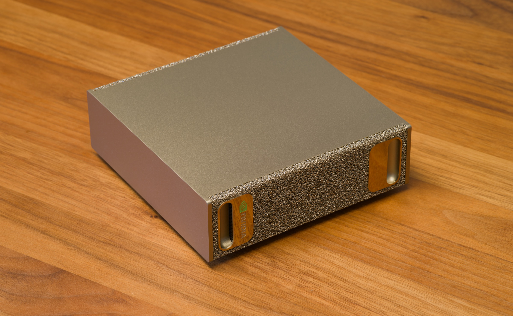
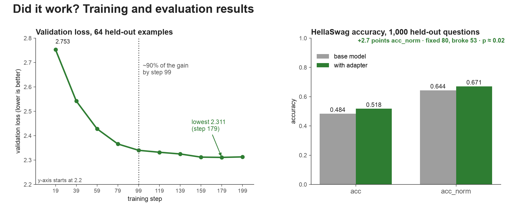

# dgx-spark-lightning-lora

**Fine-tuning NVIDIA's Nemotron 3.5 Lightning (30B-A3B) with LoRA on one DGX Spark, using NVIDIA's NeMo AutoModel recipe, and measuring the adapter against the base model through vLLM.** A step-by-step guide with every command, the recipe, the evaluation script and the results measured on 2026-10-14. The companion blog post tells the story; this README is the manual.

> **Status:** everything below ran on one DGX Spark (GB10). Items marked `[VERIFY: …]` are still being confirmed.



*Cover photo: "Oblique view of an NVIDIA DGX Spark" by [Daniel Lu](https://commons.wikimedia.org/wiki/File:Nvidia_DGX_Spark_oblique_view_dllu.jpg), [CC BY-SA 4.0](https://creativecommons.org/licenses/by-sa/4.0/), resized.*

## Contents

Background, for context before you start: [A 30B model on a desk](#a-30b-model-on-a-desk) · [How the pieces fit together](#how-the-pieces-fit-together) · [Why LoRA, not full-parameter SFT](#why-lora-not-full-parameter-sft) · [The dataset and the SFT prompts](#the-dataset-and-the-sft-prompts)

The steps, with where each one runs and how long it took us:

| Step | | Where | Time |
|---|---|---|---|
| 1 | [Check the Spark and clone this repository](#step-1-check-the-spark-and-clone-this-repository) | Spark terminal | minutes, plus the first container pull |
| 2 | [Start NVIDIA's AutoModel container](#step-2-start-nvidias-automodel-container) | Spark terminal → `lightning-lora` | minutes |
| 3 | [Get the recipe](#step-3-get-the-recipe) | `lightning-lora` | a minute |
| 4 | [Download the model](#step-4-download-the-model) | `lightning-lora` | a 60 GB download |
| 5 | [Run the 20-step test](#step-5-run-the-20-step-test) | `lightning-lora` | several minutes to load, then a few minutes |
| 6 | [Add validation and run 200 steps](#step-6-add-validation-and-run-200-steps) | `lightning-lora` | about 24 minutes, after loading |
| 7 | [What you get](#step-7-what-you-get) | `lightning-lora` | — |
| 8 | [Free the GPU and start the vLLM container](#step-8-free-the-gpu-and-start-the-vllm-container) | second Spark terminal → `vllm-lightning` | the image pull |
| 9 | [Start the server with the adapter](#step-9-start-the-server-with-the-adapter) | `vllm-lightning` | several minutes to load and compile |
| 10 | [Check both models, then try one prompt on both](#step-10-check-both-models-then-try-one-prompt-on-both) | Spark terminal | a minute |
| 11 | [Run the full comparison](#step-11-run-the-full-comparison) | Spark terminal (the script runs inside `lightning-lora`) | about 10 minutes |

Afterwards: [Results](#results) · [Under the hood](#under-the-hood) · [If it fails](#if-it-fails) · [Next step: SFT for a custom use case](#next-step-sft-for-a-custom-use-case) · [Files in this repository](#files-in-this-repository) · [References](#references)

## A 30B model on a desk

Fine-tuning a 30-billion-parameter language model normally means a multi-GPU server. We did it on a DGX Spark, a box that sits on a desk, in about 24 minutes of training, and the adapter beat the base model on 1,000 held-out questions by a margin that survives a significance test.

The model is NVIDIA's [Nemotron 3.5 Lightning](https://huggingface.co/nvidia/NVIDIA-Nemotron-3.5-Lightning-30B-A3B-BF16): 30B parameters in total, about 3B active for any one token, in a hybrid of Mamba-2, mixture-of-experts (MoE) and attention layers, with multi-token prediction (MTP) built in. The machine is a DGX Spark: NVIDIA's GB10 Blackwell GPU with 128 GB of memory shared between CPU and GPU, on an ARM processor.

We wrote no training code. The training container (`nvcr.io/nvidia/nemo-automodel:26.08`) and the recipe are NVIDIA's; NVIDIA's CI runs this recipe on a GB10. The serving image is the vLLM project's. We added a validation set, a longer run and an evaluation. This guide has every command we ran, in order, with what to expect from each, then the measured results and what they do and don't show, and, for those who want it, what the recipe does and what happens inside a training step.

**What you need:**

- A DGX Spark running DGX OS, with Docker (part of DGX OS) and about 200 GB of free disk: 60 GB of weights, plus the container, data and checkpoints.
- A Hugging Face account, with the model's OpenMDW-1.1 terms accepted on its page.
- An afternoon. The model download is 60 GB, the 200-step run takes about 24 minutes, and scoring 1,000 questions takes about ten.

**What we'll do:** train a LoRA adapter with NVIDIA's recipe (steps 1–7), then serve the base model and the adapter side by side with vLLM and measure the difference (steps 8–11).

## How the pieces fit together


*Two containers on one Spark, linked by the shared folder, the host network and the GPU.*

Training and serving run in separate containers. `lightning-lora` is NVIDIA's AutoModel image: it trains the adapter and later runs the comparison script. `vllm-lightning` is the vLLM project's image: it serves the base model and the adapter. They never talk to each other directly; three things on the Spark connect them.

**The shared folder.** `~/nemo-shared` on the Spark is `/shared` in both containers. It holds the model cache (60 GB, stored once and read by both), the recipe, checkpoints, logs and data. Training writes the adapter there; vLLM reads it with `--lora-modules`. Nothing is copied between containers. This is the layout the steps below create:

```
~/nemo-shared/                 = /shared inside both containers
├── .cache/huggingface/        HF_HOME: the model (~60 GB), HellaSwag, your HF token (keep private)
├── configs/                   your copy of the recipe
├── checkpoints/<run>/         one folder per run: checkpoints, LATEST, LOWEST_VAL
├── logs/                      <run>.log, compare_vllm.json
├── data/                      your own JSONL (see "Next step")
├── dgx-spark-lightning-lora/  this repository, cloned in step 1
└── compare_vllm.py            the evaluation script, copied from the clone in step 11
```

**The network.** Both use `--network host`, so `localhost:8000` means the same thing in both containers and on the Spark.

**The GPU and its memory.** Both have `--gpus all`. The vLLM server reserves about 80% of the 128 GB while it's up and training needs about 62 GiB, so you train or serve, not both. An idle training container uses no GPU memory.

What survives what:

| Location | Leave the shell, `docker start` | `docker rm` | Spark reboot |
|---|---|---|---|
| `/shared` = `~/nemo-shared` | Kept | Kept | Kept |
| The container's own layer: `/root`, `/tmp`, installed packages such as tmux, edits outside `/shared` | Kept | Deleted | Kept (container stopped; `docker start -ai lightning-lora`) |
| Running processes: a training run, tmux sessions | Ended | Ended | Ended |
| The image: `/opt/Automodel`, `/opt/venv` as shipped | Kept | Kept until `docker rmi` | Kept |
| GPU memory and `/dev/shm` | Cleared | Cleared | Cleared |

Rule of thumb: if you'd be upset to lose it, put it under `/shared`; and to step away while something is running in the container, detach from it (`Ctrl-p` then `Ctrl-q`, see step 2) rather than exit. The Hugging Face token file in `/shared` grants access to your account, so don't share the folder as a whole.

## Why LoRA, not full-parameter SFT

Both are supervised fine-tuning (SFT): training on examples of the behaviour you want. Ideally we'd use full-parameter SFT, which updates all 30 billion weights. But training every weight with the AdamW optimizer needs roughly 360–480 GB for weights, gradients and optimizer state. NVIDIA's own full-weight recipe for this model uses two DGX Stations. The Spark has 128 GB, shared with the system. So we use LoRA: the base model stays frozen, and we train small adapter matrices instead. The whole run fits in about 62 GiB.


*Memory to fine-tune a 30B model: full-parameter SFT with AdamW, estimated from bytes per weight before activations, against LoRA SFT as measured on the Spark.*

[LoRA](https://arxiv.org/abs/2106.09685) (low-rank adaptation) trains two small matrices per adapted linear layer; their product is the update to the frozen weight. The recipe uses rank 8 (`dim`, the matrices' width) with `alpha: 32`, and skips Mamba's `out_proj` layers, whose kernel reads the weight directly:

```yaml
peft:
  _target_: nemo_automodel.components._peft.lora.PeftConfig
  exclude_modules: ["*.out_proj"]  # Mamba out_proj takes its weight directly, so LoRA cannot wrap it.
  dim: 8
  alpha: 32
  use_triton: true
  use_memory_efficient_lora: true
```

Two qualifications. The limit is the model's size, not the Spark's: NVIDIA's GB10 recipes include a full fine-tune of Qwen3-8B (`qwen3_8b_squad_spark.yaml`). And LoRA isn't a consolation prize: with small datasets it often matches full-parameter training, which overwrites more of what the model knows, and NVIDIA's own [customization guidance](https://docs.nvidia.com/nemo/microservices/latest/customizer/about.html) recommends LoRA as the starting point for most use cases.

## The dataset and the SFT prompts

[HellaSwag](https://huggingface.co/datasets/Rowan/hellaswag) is a benchmark of everyday scenes: a context and four endings, one of them right. Here is row 14,225 of the training split, as the dataset stores it:

> **Context:** A couple is outside with a bucket and a dog. The dog is running around trying to avoid a bath. they
>
> 0. rinse the bucket off with soap and blow dry the dogs head.
> 1. use a hose to keep it from getting soap.
> 2. **get the dog wet, then it runs away again.** (correct)
> 3. hose the dog off with soap and a diaper.

Notice the lowercase "they" and "dogs" without an apostrophe: HellaSwag has formatting habits, and the adapter will learn them too (see [Results](#results)).

AutoModel's `HellaSwag` class turns each row into one training example: the context followed directly by the correct ending, as raw text with no chat template and no separator between the two (it tokenizes them separately and concatenates the token lists). The loss is scored on the ending only, because the context's tokens are labelled `-100`, the value PyTorch's cross-entropy ignores. In the recipe that's two blocks:

```yaml
loss_fn:
  _target_: nemo_automodel.components.loss.masked_ce.MaskedCrossEntropy

dataset:
  _target_: nemo_automodel.components.datasets.llm.hellaswag.HellaSwag
  path_or_dataset: rowan/hellaswag
  split: train
```

The scale is small: 200 steps of 8 examples is 1,600 training examples, about 4% of the 39,905-row training split. Validation used 64 examples from the validation split, and the final evaluation 1,000 more that training never saw. At evaluation the model doesn't write an answer; it's shown each ending after the context and asked how likely it is, and the most likely one is its pick, as in the [lm-evaluation-harness](https://github.com/EleutherAI/lm-evaluation-harness).

It's a demonstration task: it teaches scene continuation and HellaSwag's way of writing, proves the pipeline and gives a clean before-and-after measurement, but it isn't a skill most people need, which is why the [last section](#next-step-sft-for-a-custom-use-case) swaps the data.

## Train: from a fresh Spark to an adapter, step by step

### Step 1: Check the Spark and clone this repository

On the Spark's own terminal, not inside a container:

```bash
nvidia-smi              # "NVIDIA GB10", "CUDA Version: 13.x"
uname -m                # aarch64: the Spark's CPU is ARM
free -g                 # ~120 GB total; close other big programs first
df -h ~                 # ~200 GB free
docker version          # Docker is part of DGX OS
docker run --rm --gpus all nvcr.io/nvidia/nemo-automodel:26.08 nvidia-smi -L
```

The last line pulls NVIDIA's container and checks that it sees the GPU; it's large, so the first pull takes a while. It should print `GPU 0: NVIDIA GB10`. A "CUDA Forward Compatibility mode ENABLED" note is normal, and the 64 MB shared-memory warning goes away with the flags in step 2. If `docker` needs `sudo`, add yourself to the group once: `sudo usermod -aG docker "$USER" && newgrp docker`.

Then create the shared folder and clone this repository into it, so the recipe and the evaluation script are at hand inside the containers (steps 3 and 11 each have a download alternative if you'd rather not clone; if `git` is missing, `sudo apt-get install -y git`):

```bash
mkdir -p ~/nemo-shared
git clone https://github.com/priyanlc/dgx-spark-lightning-lora ~/nemo-shared/dgx-spark-lightning-lora
```

### Step 2: Start NVIDIA's AutoModel container

On the Spark, start a named container with the shared folder mounted at `/shared`. The flags follow NVIDIA's DGX Station guide for this model, plus the thread count from the recipe's own header and an allocator setting:

```bash
mkdir -p ~/nemo-shared
docker run -it \
  --name lightning-lora \
  --gpus all --network host \
  --shm-size=32g --ulimit memlock=-1 --ulimit stack=67108864 \
  -e HF_HOME=/shared/.cache/huggingface \
  -e OMP_NUM_THREADS=8 -e MKL_NUM_THREADS=8 \
  -e PYTORCH_CUDA_ALLOC_CONF=expandable_segments:True \
  -v ~/nemo-shared:/shared \
  nvcr.io/nvidia/nemo-automodel:26.08
```

- `-v ~/nemo-shared:/shared`: everything you keep goes under `/shared`.
- `HF_HOME`: the model download lands in `/shared`, so it isn't downloaded again next time.
- `OMP_NUM_THREADS=8`: NVIDIA's recipe asks for 8 CPU threads while loading the experts.
- `--shm-size=32g`: shared memory for data loading. NVIDIA's guide uses 128g on a much larger Station; 32g leaves the Spark's unified memory for the model.

If you leave the container's shell it stops, and anything running in it ends; come back with `docker start -ai lightning-lora`. To step out *without* stopping it, press `Ctrl-p` then `Ctrl-q` (Docker's detach keys); `docker attach lightning-lora` takes you back. Steps 8, 10 and 11 run on the Spark itself, so the simplest arrangement is a second terminal on the Spark for those, leaving this one in the container. Inside the container, check the installation:

```bash
nvidia-smi -L
python3 -c 'import nemo_automodel; print(nemo_automodel.__version__)'
python3 -c 'from nemo_automodel.components._peft.lora import PeftConfig; print("LoRA OK")'
```

On the tested Spark, the training log reports nemo_automodel 0.5.0+922e83e42, transformers 5.12.1 and torch 2.13 (nv26.06) with CUDA 13.3, and "Using custom model implementation for NemotronHForCausalLM", which is AutoModel's own Nemotron-H code.

### Step 3: Get the recipe

Inside `lightning-lora`. Copy the recipe into `/shared`, so your edits are kept. The copy in this repository is NVIDIA's file, verbatim from [AutoModel's main branch](https://github.com/NVIDIA-NeMo/Automodel/blob/main/examples/llm_finetune/nemotron/nemotron_nano_v3_5_lightning_singlegpu_lora.yaml), and it is the one the results in this guide were measured with:

```bash
mkdir -p /shared/configs /shared/checkpoints /shared/logs
R=nemotron_nano_v3_5_lightning_singlegpu_lora.yaml
cp /shared/dgx-spark-lightning-lora/configs/$R /shared/configs/
head -30 /shared/configs/$R
```

Without a clone, download the same file: `curl -fL https://raw.githubusercontent.com/NVIDIA-NeMo/Automodel/main/examples/llm_finetune/nemotron/$R -o /shared/configs/$R`. The container ships its own copy under `/opt/Automodel/examples/llm_finetune/nemotron/`, which may be older. The main-branch file is newer than the container's AutoModel, and that worked here: NVIDIA's DGX Station recipe for this model runs on the same 26.08 container with the same model and backend settings. If a setting is rejected, the error names it (see [If it fails](#if-it-fails)).

### Step 4: Download the model

Still inside `lightning-lora`. The model is under NVIDIA's OpenMDW-1.1 licence; accept its terms on the model page if asked. Then log in and download about 60 GB:

```bash
hf auth login            # token from huggingface.co/settings/tokens
hf download nvidia/NVIDIA-Nemotron-3.5-Lightning-30B-A3B-BF16
du -sh /shared/.cache/huggingface
```

Downloading first keeps network problems separate from training problems. HellaSwag is small and downloads when training starts.

### Step 5: Run the 20-step test

Inside `lightning-lora`. Start tmux so the run survives a dropped connection (`Ctrl-b d` detaches from tmux and `tmux attach -t train` returns; `Ctrl-p` `Ctrl-q` then detaches from the container, as in step 2), then run the recipe as NVIDIA ships it, with only the checkpoint folder changed:

```bash
apt-get update && apt-get install -y tmux && tmux new -s train
cd /opt/Automodel
CUDA_VISIBLE_DEVICES=0 automodel /shared/configs/nemotron_nano_v3_5_lightning_singlegpu_lora.yaml \
  --nproc-per-node 1 \
  --checkpoint.checkpoint_dir /shared/checkpoints/lightning-test \
  2>&1 | tee /shared/logs/lightning-test.log
```

What to expect:

- **Loading takes several minutes.** AutoModel reads the checkpoint and loads the split experts straight into its grouped layout. The terminal can be quiet; watch `top` in a second tmux window (`Ctrl-b c`).
- **20 lines** like `step N | loss … | grad_norm … | lr … | mem … GiB | tps …`, a few seconds apart. The loss should fall over the 20 steps.
- **A saved adapter** in `/shared/checkpoints/lightning-test/` at the end.

Check memory from another window with `free -g`. On the GB10, `nvidia-smi` can't show a GPU memory figure, because the CPU and GPU share one memory pool.

### Step 6: Add validation and run 200 steps

Inside `lightning-lora`, in the tmux session. The recipe has no validation set, so it only reports training loss. For a run you can judge, append a validation block to your copy of the recipe. It's the same block NVIDIA uses in its multi-GPU HellaSwag LoRA recipes (also in this repository as `configs/validation-block.yaml`):

```bash
cat >> /shared/configs/nemotron_nano_v3_5_lightning_singlegpu_lora.yaml <<'EOF'

validation_dataset:
  _target_: nemo_automodel.components.datasets.llm.hellaswag.HellaSwag
  path_or_dataset: rowan/hellaswag
  split: validation
  num_samples_limit: 64

validation_dataloader:
  _target_: torchdata.stateful_dataloader.StatefulDataLoader
  collate_fn: nemo_automodel.components.datasets.utils.default_collater
EOF
```

`tail -12 /shared/configs/nemotron_nano_v3_5_lightning_singlegpu_lora.yaml` should show the block once; running the command twice appends it twice.

Then start the real run. The 200 steps take about 24 minutes, at about 7 s each including the validation checks, after a few minutes of loading. This version names each run after the date and time, refuses to reuse a folder that already exists, and gives the log the same name, so you can't resume a finished run or overwrite a log by mistake:

```bash
cd /opt/Automodel
RUN=lightning-200-$(date +%m%d-%H%M)
test -e /shared/checkpoints/$RUN && echo "exists, pick another name" || \
CUDA_VISIBLE_DEVICES=0 automodel /shared/configs/nemotron_nano_v3_5_lightning_singlegpu_lora.yaml \
  --nproc-per-node 1 \
  --step_scheduler.max_steps 200 --step_scheduler.val_every_steps 20 \
  --checkpoint.checkpoint_dir /shared/checkpoints/$RUN \
  2>&1 | tee /shared/logs/$RUN.log
echo "run: $RUN"; grep "\[val\]" /shared/logs/$RUN.log
```

The two overrides are everything that differs from NVIDIA's recipe: `--step_scheduler.max_steps 200` and `--step_scheduler.val_every_steps 20`. Change 200 in both places for a different length.

While it runs, every step prints loss, gradient norm, learning rate, memory and tokens per second (training loss was 2.90 at step 0 and 2.78 at step 1), and every 20 steps a `[val]` line reports the loss on the 64 held-out examples. It should fall over the run, though not necessarily at every check: ours rose by a thousandth at the last one (see [Results](#results)). A `LOWEST_VAL` link in the checkpoint folder points to the best saved one.

Three things to know about run folders:

- **One folder per run.** If `--checkpoint.checkpoint_dir` already holds checkpoints, AutoModel resumes from the latest one instead of starting over. If that run already reached `max_steps`, it trains nothing: the log shows `Loading checkpoint from …/epoch_0_step_199` and the progress bar jumps straight to the end. `tee` also overwrites an existing log of the same name. The `RUN=…` pattern above prevents both.
- **To train longer, start a fresh run.** Resuming an old folder with a higher `max_steps` works, but the learning-rate schedule restored from the checkpoint is as long as the old run, so the extra steps run at the minimum rate (1e-5). Check the `lr` column to see which you got.
- **Only the final step is saved** by default (the recipe checkpoints every 1,000 steps plus at the end), so after a 200-step run `LOWEST_VAL` points to step 199. Add `--step_scheduler.ckpt_every_steps 20` to keep a checkpoint at every validation.

If a log was overwritten anyway, two things recover the results: `readlink /shared/checkpoints/<run>/LOWEST_VAL` names the best step, and, if the run was in the same tmux window, `tmux capture-pane -p -S -200000 > /shared/logs/recovered.txt` saves what tmux still remembers.

When the run has finished, give it the name the rest of this guide uses, `lightning-200`. These are relative links inside `/shared`, so they resolve in both containers and on the Spark, and every later command works as written:

```bash
ln -sfn $RUN /shared/checkpoints/lightning-200
ln -sf $RUN.log /shared/logs/lightning-200.log
```

If you've opened a new shell since and `$RUN` is gone, `ls /shared/checkpoints/` shows the folder's name.

### Step 7: What you get

Inside `lightning-lora` (the trailing slash makes `find` follow the `lightning-200` link):

```bash
find /shared/checkpoints/lightning-200/ -maxdepth 4 \( -name "*.json" -o -name "*.safetensors" \) | sort
ls -lh /shared/checkpoints/lightning-200/LOWEST_VAL/model/
```

`adapter_model.safetensors` and `adapter_config.json` are the LoRA adapter, in Hugging Face PEFT format, small compared with the 60 GB model. To use it, load the base model and apply the adapter (what vLLM does in step 9), or merge them. The run folder holds more than the adapter:

| Path | What it is |
|---|---|
| `training.jsonl` | One JSON line per step: loss, grad_norm, lr, mem, tps, mfu, token counts. The metrics survive even if the terminal log is lost. |
| `validation.jsonl` | One line per validation check: val_loss, lr, mem. |
| `LATEST`, `LOWEST_VAL` | Links to the newest checkpoint and the best saved one. |
| `epoch_0_step_N/model/` | The adapter (`adapter_model.safetensors`, `adapter_config.json`), `automodel_peft_config.json`, and a copy of the tokenizer and chat template. |
| `epoch_0_step_N/optim/`, `dataloader/`, `rng/`, `step_scheduler.pt` | Optimizer, data position, random state and step counter, used to resume exactly. |
| `epoch_0_step_N/config.yaml` | The full config the run used, including command-line overrides. |

Everything is under `~/nemo-shared` on the Spark, so it stays after the container is removed. That's the training done. What the recipe's settings mean, and what happened inside each step, is explained in [Under the hood](#under-the-hood), after the results.

## Evaluate: serve the base model and the adapter with vLLM

[vLLM](https://github.com/vllm-project/vllm) is a fast inference server with an OpenAI-style API. Following [Arm's DGX Spark fine-tuning guide](https://learn.arm.com/learning-paths/laptops-and-desktops/pytorch-finetuning-on-spark/4-testing/), we run it in its own container and send the same prompts to the original and the fine-tuned model. One difference: vLLM can load the LoRA adapter directly on top of the base model, so a single server answers as both, with no merging.

Which vLLM: NVIDIA's Lightning cookbook uses `vllm/vllm-openai:v0.27.1` and lists a tested DGX Spark configuration for it. NVIDIA's Spark settings are for the 4-bit NVFP4 checkpoint; the adapter was trained on BF16, so the command below serves BF16 with a smaller context window.

### Step 8: Free the GPU and start the vLLM container

Open a second terminal on the Spark for steps 8 to 11; the server you start in step 9 keeps its terminal busy. Make sure no training run is active: `free -g` on the Spark should show most of the memory free again. The `lightning-lora` container can stay as it is, stopped or idle; it only uses the GPU while training. On the Spark host:

```bash
docker pull vllm/vllm-openai:v0.27.1
docker run -it --rm --name vllm-lightning \
  --gpus all --ipc=host --network host \
  -v ~/nemo-shared:/shared \
  -e HF_HOME=/shared/.cache/huggingface \
  --entrypoint /bin/bash \
  vllm/vllm-openai:v0.27.1
```

- `-v ~/nemo-shared:/shared` and `HF_HOME`: vLLM reuses the model you already downloaded and can read your adapter.
- `--network host`: the server is reachable at `localhost:8000` from the Spark and from the training container.
- `--ipc=host`: shared memory for vLLM, as in NVIDIA's and Arm's commands.

### Step 9: Start the server with the adapter

Inside the vLLM container. This points at the step-199 adapter from the 200-step run:

```bash
vllm serve nvidia/NVIDIA-Nemotron-3.5-Lightning-30B-A3B-BF16 \
  --served-model-name lightning-base \
  --max-model-len 8192 \
  --gpu-memory-utilization 0.80 \
  --mamba-backend flashinfer \
  --enable-lora --max-lora-rank 8 \
  --lora-modules lightning-hellaswag=/shared/checkpoints/lightning-200/epoch_0_step_199/model
```

- `--served-model-name lightning-base`: the base model's name in requests.
- `--lora-modules lightning-hellaswag=…`: the adapter's name. Requests to this name use base + adapter.
- `--max-lora-rank 8`: matches the recipe's LoRA rank (`dim: 8`).
- `--max-model-len 8192`: enough for these tests, and keeps the KV cache small. NVIDIA's Spark example uses 1M tokens with the 4-bit model.
- `--gpu-memory-utilization 0.80`: the share of the 128 GB unified pool vLLM may take, leaving the rest for the OS. The BF16 weights alone are about 60 GB.
- `--mamba-backend flashinfer`: the Mamba kernels from NVIDIA's Lightning commands.

The first start is slow: loading 60 GB, then compiling kernels. NVIDIA's cookbook warns that progress can sit at 0% for minutes. Wait for `Application startup complete`.

### Step 10: Check both models, then try one prompt on both

On the Spark, in a terminal other than the server's:

```bash
curl -s http://localhost:8000/v1/models | python3 -m json.tool | grep '"id"'
```

You should see `lightning-base` and `lightning-hellaswag` (the `modelperm-…` ids are vLLM's permission records, not extra models). The adapter was trained on raw text continuations, so use the completions endpoint:

```bash
for M in lightning-base lightning-hellaswag; do
  echo "== $M"
  curl -s http://localhost:8000/v1/completions -H "Content-Type: application/json" -d "{
    \"model\": \"$M\",
    \"prompt\": \"A woman is outside with a bucket and a dog. The dog is running around trying to avoid a bath. She\",
    \"max_tokens\": 40, \"temperature\": 0
  }" | python3 -c "import sys,json; print(json.load(sys.stdin)['choices'][0]['text'])"
done
```

On the tested Spark:

| Model | Continuation after "…She" |
|---|---|
| **lightning-base** | is trying to catch the dog with the bucket. The dog is jumping over a fence. The woman is chasing the dog. The dog is running away. The woman is trying to catch the dog. |
| **lightning-hellaswag** | is trying to get the dog in the tub. The dog jumps out of the tub and runs away. The woman chases the dog around the yard. The dog jumps into the tub and the woman |

The base drifts (a fence appears) and repeats itself; the adapter stays on the bath. If the two continuations are identical, the adapter may not be applied; check the server output for LoRA warnings. But one prompt is a hint, not a measurement, and this one is a near-copy of a training-split scene (see [The dataset](#the-dataset-and-the-sft-prompts)). Step 11 measures.

### Step 11: Run the full comparison

`compare_vllm.py` (in this repository) sends the same requests to both names. It prints side-by-side continuations, then HellaSwag accuracy: for each question it asks the server for the log-probability of each of the four endings after the context, using `echo` and `logprobs` so the server scores the prompt itself, and picks the most likely, as lm-eval does. It skips the 64 validation rows the training run used, and reports how many answers the adapter fixed and broke. This is its core:

```python
def ending_logprobs(a, model, ctx, endings):
    """Log-probability of each ending after ctx, from the server's prompt logprobs."""
    prompts = [ctx + " " + e for e in endings]
    r = call(a.url, "/completions", {"model": model, "prompt": prompts, "max_tokens": 1,
                                     "temperature": 0, "echo": True, "logprobs": 0})
    totals = [0.0] * len(prompts)
    for ch in r["choices"]:
        i = ch["index"]
        lp = ch["logprobs"]
        start = len(ctx)
        # the echoed prompt tokens come first; the 1 generated token is last
        for tok_lp, off in zip(lp["token_logprobs"][:-1], lp["text_offset"][:-1]):
            if off >= start and tok_lp is not None:
                totals[i] += tok_lp
    per_char = [t / max(len(e), 1) for t, e in zip(totals, endings)]
    return totals, per_char
```

`totals` gives **acc**: the pick is the ending with the highest total log-probability. `per_char` gives **acc_norm**, which divides by the ending's length in characters so longer endings aren't penalised; it's lm-eval's headline HellaSwag number.

The script needs only the Python standard library plus `datasets`, so run it from the training container, which has `datasets` and shares the network with the server. On the Spark, in the second terminal: copy it from the clone to the shared folder, run a small test, then the full 1,000 questions (about 10 minutes):

```bash
cp ~/nemo-shared/dgx-spark-lightning-lora/compare_vllm.py ~/nemo-shared/
docker start lightning-lora
docker exec -it lightning-lora python3 /shared/compare_vllm.py --n 20 --gen 2
docker exec -it lightning-lora python3 /shared/compare_vllm.py --n 1000
```

Without a clone, fetch the script with `curl -fL https://raw.githubusercontent.com/priyanlc/dgx-spark-lightning-lora/main/compare_vllm.py -o ~/nemo-shared/compare_vllm.py` instead. `docker exec` needs a running container, and `lightning-lora` stops whenever you leave its shell; `docker start` without `-ai` starts it in the background, where it does nothing on the GPU until you run something in it. `docker ps` should show both containers. Results are saved to `~/nemo-shared/logs/compare_vllm.json`. When you're done, stop the server with Ctrl-C; the container removes itself.

**If the adapter won't load**, merge it into a standalone model and serve that instead, the route Arm's guide takes. AutoModel documents a merge tool; check that it's in your container first, inside `lightning-lora`:

```bash
ls /opt/Automodel/tools/merge_lora.py && \
python3 /opt/Automodel/tools/merge_lora.py \
  --base-model nvidia/NVIDIA-Nemotron-3.5-Lightning-30B-A3B-BF16 \
  --adapter-path /shared/checkpoints/lightning-200/epoch_0_step_199/model \
  --output-dir /shared/merged/lightning-hellaswag \
  --automodel-native-export --dtype bfloat16
```

This writes a full ~60 GB copy (`--dtype bfloat16` keeps the base's precision; the tool's default is float16). Then serve `--model /shared/merged/lightning-hellaswag --served-model-name lightning-hellaswag` without the LoRA flags, and in a second session the base model as `lightning-base`, running `compare_vllm.py` while each is up.

## Results



*Left: validation loss on 64 held-out examples at each of the 10 checks; the y-axis starts at 2.2. Right: HellaSwag accuracy on 1,000 held-out questions, base model against adapter.*

**Training.** 200 steps took about 24 minutes (09:03:28 to 09:27:15), about 7 s per step including the 10 validation checks, at about 62 GiB of memory. Throughput was about 107 tokens/s, low because HellaSwag examples are short (624–760 tokens per step) and per-step overhead dominates. The numbers below come from the run's `validation.jsonl` (also in `results/validation-loss.csv`):

| Step | 19 | 39 | 59 | 79 | 99 | 119 | 139 | 159 | 179 | 199 |
|---|---|---|---|---|---|---|---|---|---|---|
| Validation loss | 2.753 | 2.542 | 2.428 | 2.366 | 2.340 | 2.332 | 2.325 | 2.312 | **2.311** | 2.313 |
| Learning rate | 9.8e-5 | 9.2e-5 | 8.2e-5 | 7.0e-5 | 5.6e-5 | 4.2e-5 | 2.9e-5 | 1.9e-5 | 1.2e-5 | 1.0e-5 |

Validation loss measures how well the model predicts the correct endings of examples it isn't trained on; lower is better. It fell steadily, with about 90% of the improvement by step 99 and a flat curve after step 159: for this data, 200 steps was plenty.

**Answer quality.** A falling loss shows the adapter learned; it doesn't say how often the model now picks the right ending. Step 11 does. HellaSwag validation rows 64–1063, 1,000 questions used for neither training nor validation, scored through the vLLM server in 566 s:

| | Base | Adapter | Change |
|---|---|---|---|
| acc_norm | 0.644 | **0.671** | +2.7 points |
| acc | 0.484 | 0.518 | +3.4 points |
| Mean log-prob of the correct ending | −34.41 | −33.82 | +0.59 |
| Answers fixed / broken (acc_norm) | | 80 / 53 | net +27 |

Is +2.7 points real? The adapter fixed 80 answers and broke 53. A paired **McNemar test** looks only at those disagreements and asks how likely an 80-to-53 split would be if the adapter made no difference: p ≈ 0.02, about a 2% chance. The paired 95% range for the gain is about +0.5 to +4.9 points. Sample size mattered: a first run on 100 questions showed +2 points with 8 fixed and 6 broken, indistinguishable from chance. Use `--n 1000` for a decision.

**What to make of it.** The gain is real but modest, which is typical when the base model already handles the task reasonably well. Part of it is style: the adapter's free text now drops the space after a full stop and starts sentences in lowercase ("rinsed with water.the car is then dried"), copying HellaSwag's formatting; the lowercase "they" in [The dataset](#the-dataset-and-the-sft-prompts) is where that comes from, and the missing spaces come from the training format: AutoModel's `SFTSingleTurnPreprocessor` tokenizes context and ending separately and concatenates the token lists with nothing between them, so the model learned context glued to ending. `compare_vllm.py` scores `ctx + " " + ending`, with a space, so the accuracy figures slightly understate the adapter. And the absolute scores sit below published HellaSwag figures because the prompt is plain, without lm-eval's activity-label prefix, on a model tuned for chat and reasoning. Compare base against adapter, not against leaderboards.

## Under the hood

Two explanations for readers who want to know what the recipe does and what happens inside a training step. Nothing here is needed to run the steps.

### The recipe's settings, explained

The full recipe is `configs/nemotron_nano_v3_5_lightning_singlegpu_lora.yaml` in this repository. These are the settings that matter, and what each one does:

| Setting | Value | What it does |
|---|---|---|
| `step_scheduler` | global 8, local 1, 20 steps | 8 examples per update, processed one at a time and accumulated (8 passes per step on one GPU). |
| `num_nextn_predict_layers`, `mtp_use_repeated_layer`, `mtp_loss_scaling_factor` | 2, true, 0.1 | Keeps Lightning's multi-token prediction training on: the checkpoint's one MTP layer is reused to predict 2 extra tokens ahead, adding 0.1 × its loss. |
| `backend` | attn `te`, linear `torch`, rms_norm `torch_fp32`, experts `torch_mm`, dispatcher `torch` | Kernel choices: Transformer Engine attention, PyTorch grouped matrix multiplies for the experts, no DeepEP. All experts stay on the one GPU. |
| `peft` | dim 8, alpha 32, exclude `*.out_proj`, Triton, memory-efficient LoRA | LoRA adapters on the model's linear layers. Mamba's `out_proj` is skipped because its kernel reads the weight directly. Memory-efficient LoRA doesn't keep one intermediate tensor, saving memory. |
| `distributed` | fsdp2, every size 1, activation checkpointing on | One process, no model splitting. Activations are recomputed in the backward pass to save memory. |
| `dataset` | HellaSwag train | Context plus correct ending; the loss is scored on the ending only. |
| `optimizer` / `lr_scheduler` | AdamW 1e-4, betas 0.9/0.95, weight decay 0.1; 2 warm-up steps, cosine to 1e-5 | A LoRA-sized learning rate with a short warm-up. |
| `checkpoint` | safetensors, `save_consolidated: final` | Writes the adapter at the end of the run. |

### Inside a training step: precision, FSDP2 and memory

**Number formats.** The recipe sets no model dtype, so the frozen base weights load as they ship, in **bf16**: a 16-bit floating-point format with fp32's exponent range but far fewer digits of precision. It halves the memory, and the maths runs in it too. Two things stay in **fp32** because they're sensitive to rounding: the normalisation layers (`rms_norm: torch_fp32` in the recipe, `Float32RMSNorm` in the log) and a few small Mamba-2 parameters (`NemotronV3MambaFP32Params` in the log). The LoRA weights and their AdamW state are fp32 too, as in NVIDIA's comparable Nemotron recipes. [VERIFY: run the check at the end of this section and state the result.]

**FSDP2 on one GPU.** FSDP2, PyTorch's Fully Sharded Data Parallel, splits weights and optimizer state across GPUs so each holds a slice. With one GPU there's nothing to split, and AutoModel skips it; the recipe keeps `strategy: fsdp2` so the same file scales to more GPUs unchanged. Likewise `ep_size: 1` keeps every expert on the one GPU, so tokens never cross to another device. The log says so, next to the other lines that shape a step:

```
World size or FSDP mesh size is 1, skipping parallelization.
Applied submodule activation checkpointing to 52 layers: {'mlp': 23, 'attention': 29, …}
Gradient accumulation steps: 8
No clip_grad_norm.max_norm specified in config, using default value of 1.0
```

**One optimizer step, in order.**

1. Take 8 micro-batches of one example each (`global_batch_size: 8`, `local_batch_size: 1`).
2. Run each forward pass in bf16 through the 52 layers, with **activation checkpointing** on all of them: a layer keeps only its input and recomputes the rest in the backward pass, trading compute for memory.
3. Compute the loss on the ending tokens, plus 0.1 × the multi-token-prediction loss from the MTP layer predicting two extra tokens ahead.
4. Run the backward pass; only the LoRA weights receive gradients.
5. Add up the 8 passes' gradients (**gradient accumulation**).
6. Clip the combined gradient to a norm of 1.0.
7. Let AdamW (betas 0.9/0.95, weight decay 0.1) update the adapter, at a learning rate that warms up over 2 steps to 1e-4 and decays along a cosine curve to 1e-5.

**Memory.** About 60 GB of base weights, plus a small adapter and activations kept small by short examples and checkpointing: the run reported about 62 GiB of 128 GB. Longer sequences ([Next step](#next-step-sft-for-a-custom-use-case)) need more.

**Check it yourself.** Inside the container, after a run, print the adapter's number formats and size, and confirm the fp32 modules and checkpoint wrappers in the log:

```bash
python3 - <<'PY'
import glob, collections
from safetensors import safe_open
f = glob.glob("/shared/checkpoints/lightning-200/LOWEST_VAL/model/adapter_model.safetensors")[0]
h = safe_open(f, "pt"); dtypes = collections.Counter(); n = 0
for k in h.keys():
    t = h.get_tensor(k); dtypes[str(t.dtype)] += 1; n += t.numel()
print(f"{n/1e6:.1f}M adapter parameters, tensor formats: {dict(dtypes)}")
PY
grep -m3 -E "Float32RMSNorm|MambaFP32Params|CheckpointWrapper" /shared/logs/lightning-200.log
```

If the formats show `torch.float32`, the adapter trained in fp32 as described.

## If it fails

Training:

| You see | Likely cause | Fix |
|---|---|---|
| `no matching manifest for linux/arm64` | No ARM build of that container tag | Use a tag with an ARM build; NVIDIA's cookbooks name them. |
| `401` / `GatedRepoError` | Not logged in, or the model's terms not accepted | Accept the terms on the model page; run `hf auth login` again. |
| Config error naming a key (for example `mtp_use_repeated_layer`) | The container's AutoModel is older than the recipe | Fall back to NVIDIA's DGX Station config for this model, which is validated on 26.08. |
| CUDA out of memory, or the Spark becomes unresponsive | The 128 GB pool is shared with everything else running | Close other programs and containers. Check `free -g`. Keep `local_batch_size: 1`. |
| Very slow loading | Few CPU threads for loading the experts | Check that `echo $OMP_NUM_THREADS` prints 8 inside the container. |
| Error about wrapping a Mamba `out_proj` | The LoRA exclusion was removed | Keep `exclude_modules: ["*.out_proj"]`. |
| Training finishes instantly: `Loading checkpoint from …`, then the bar at the end | The checkpoint folder already holds a finished run, so AutoModel resumed it | Use a new `--checkpoint.checkpoint_dir` and log name for each run (step 6). |
| No checkpoint after the run | The run stopped early, or the wrong path | `find /shared/checkpoints -type f`. The adapter is written only when the run finishes. |

Serving and evaluation:

| You see | What to do |
|---|---|
| `no matching manifest for linux/arm64` on pull | That vLLM tag has no ARM build; check NVIDIA's Lightning cookbook for a newer tag. |
| Server error mentioning LoRA or unsupported modules | Use the merge route at the end of step 11. |
| Out of memory while starting | Lower `--gpu-memory-utilization` to 0.75 or `--max-model-len` to 4096, and close other programs. |
| An error naming `--mamba-backend` | Remove that flag and try again. |
| `Error response from daemon: container … is not running` | The training container is stopped. Run `docker start lightning-lora`, then the `docker exec` command again. |
| Connection refused from curl or the script | The server isn't ready yet; wait for `Application startup complete`. |
| `HellaSwag scoring failed … prompt logprobs` | This vLLM didn't return log-probabilities for the prompt. The side-by-side results are still valid. |

## Next step: SFT for a custom use case

Everything above transfers to your own data. Swap the recipe's dataset block for NVIDIA's JSONL prompt/completion class, the one its Nemotron "customizer" recipes use. Each line of the file is `{"prompt": "...", "completion": "..."}`:

```yaml
dataset:
  _target_: nemo_automodel.components.datasets.llm.column_mapped_text_instruction_dataset.ColumnMappedTextInstructionDataset
  path_or_dataset_id: /shared/data/train.jsonl
  split: train
  column_mapping:
    question: prompt
    answer: completion
  seq_length: 2048
  answer_only_loss_mask: true
  padding: do_not_pad
  truncation: longest_first
```

`answer_only_loss_mask: true` does for your completions what the HellaSwag class did for the endings. Replace the `validation_dataset` block the same way, pointing at a held-out file (`split` is ignored for local files, which always load as a single split):

```yaml
validation_dataset:
  _target_: nemo_automodel.components.datasets.llm.column_mapped_text_instruction_dataset.ColumnMappedTextInstructionDataset
  path_or_dataset_id: /shared/data/val.jsonl
  split: train
  column_mapping:
    question: prompt
    answer: completion
  seq_length: 2048
  answer_only_loss_mask: true
  padding: do_not_pad
  truncation: longest_first
```

Both blocks are in `configs/custom-dataset-block.yaml`. Two things to know. By default (`use_hf_chat_template: false`) the class trains on plain text, `prompt + completion` with nothing in between, exactly as the HellaSwag class did, so end each prompt with the separator you want the model to learn (a newline, say); set `use_hf_chat_template: true` to train in the tokenizer's chat format instead, and then test through the chat endpoint rather than `/v1/completions`. And run 20 steps first: we haven't tested this swap on the Lightning recipe yet, and longer sequences use more memory than HellaSwag.

Our candidate is puzzle-style reasoning data from the Kaggle Nemotron reasoning challenge. HellaSwag is something the base model already does well; puzzles are where it's weaker, so the gain should be larger and more useful. The workflow is the same three steps: train, serve with vLLM, compare base against adapter on held-out data. There's headroom too: 62 GiB of 128 GB leaves room for the longer sequences real tasks bring.

Three things to take from this run:

- **A 30B MoE model fine-tunes on one Spark**, with NVIDIA's recipe and container unchanged, because LoRA keeps the 60 GB base frozen.
- **Loss shows it learned; a paired comparison on enough held-out data shows how much.** 100 questions couldn't tell; 1,000 could.
- **Fine-tuning learns everything in the data, formatting included.** Read your model's free text, not only its scores.

## Files in this repository

| Path | What it is |
|---|---|
| `README.md` | This guide. |
| `configs/nemotron_nano_v3_5_lightning_singlegpu_lora.yaml` | NVIDIA's recipe, verbatim from AutoModel's main branch (Apache-2.0; NVIDIA's header kept). |
| `configs/validation-block.yaml` | The validation block appended in step 6. |
| `configs/custom-dataset-block.yaml` | The JSONL prompt/completion dataset and validation blocks from "Next step". |
| `compare_vllm.py` | The evaluation script (step 11). |
| `results/validation-loss.csv` | Validation loss and learning rate at each check of the 200-step run. |
| `results/hellaswag-1000.csv` | Base against adapter on 1,000 held-out HellaSwag questions. |
| `results/README.md` | What the two CSV files contain and how they were produced. |
| `diagrams/` | The three diagrams. |
| `cover/` | The cover photo (CC BY-SA 4.0, Daniel Lu) and its credit. |
| `LICENSE.md` | Licences for each part of the repository. |

## References

- NVIDIA NeMo AutoModel: https://github.com/NVIDIA-NeMo/Automodel
- The recipe, `nemotron_nano_v3_5_lightning_singlegpu_lora.yaml`: https://github.com/NVIDIA-NeMo/Automodel/blob/main/examples/llm_finetune/nemotron/nemotron_nano_v3_5_lightning_singlegpu_lora.yaml
- Nemotron 3.5 Lightning model card: https://huggingface.co/nvidia/NVIDIA-Nemotron-3.5-Lightning-30B-A3B-BF16
- NVIDIA, Lightning LoRA on one DGX Station (the container flags this setup follows): https://github.com/NVIDIA-NeMo/Nemotron/blob/main/usage-cookbook/Nemotron-3.5-Lightning/dgx-station-recipes/lora.md
- HellaSwag: dataset https://huggingface.co/datasets/Rowan/hellaswag; paper https://arxiv.org/abs/1905.07830
- LoRA: https://arxiv.org/abs/2106.09685
- vLLM: https://github.com/vllm-project/vllm
- lm-evaluation-harness: https://github.com/EleutherAI/lm-evaluation-harness
- NVIDIA NeMo Customizer, customization concepts (LoRA as the recommended starting point): https://docs.nvidia.com/nemo/microservices/latest/customizer/about.html
- Arm, PyTorch fine-tuning on DGX Spark, testing with vLLM (the inspiration for the evaluation): https://learn.arm.com/learning-paths/laptops-and-desktops/pytorch-finetuning-on-spark/4-testing/

*Licences: the model is released under OpenMDW-1.1; the AutoModel container image is covered by the NVIDIA Software License Agreement and Product-Specific Terms for NVIDIA AI Products; HellaSwag is MIT-licensed. All measurements come from runs on one DGX Spark (GB10) on 2026-10-14.*
