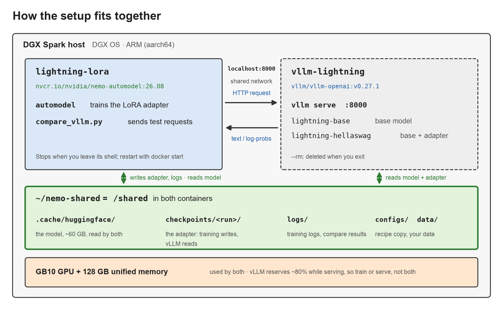
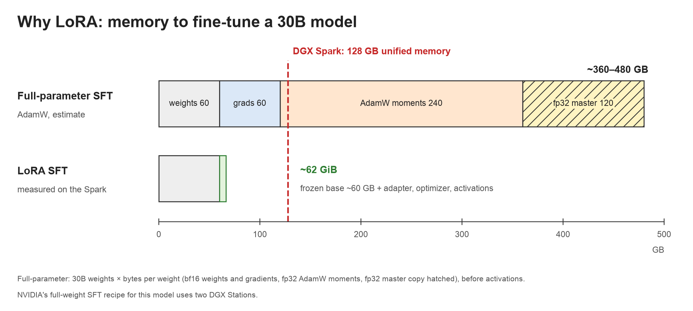

# Nemotron 3.5 Lightning 30B-A3B: LoRA on one DGX Spark, measured with vLLM

*Part of [nemotron-finetuning](../../README.md), a series of fine-tuning experiments on NVIDIA's Nemotron models.*

**Fine-tune NVIDIA Nemotron 3.5 Lightning (30B-A3B) with LoRA on a single DGX Spark, then compare the adapter with the base model using vLLM.** This README is a reproducible, step-by-step guide. It includes the commands, configuration, evaluation script and measurements from 14 October 2026.

> **Tested setup:** The training and evaluation described here ran on one DGX Spark (GB10). Any item marked `[VERIFY: ...]` still needs confirmation. The proposed custom-dataset adaptation at the end has not yet been tested.


*Cover photo: "Oblique view of an NVIDIA DGX Spark" by [Daniel Lu](https://commons.wikimedia.org/wiki/File:Nvidia_DGX_Spark_oblique_view_dllu.jpg), [CC BY-SA 4.0](https://creativecommons.org/licenses/by-sa/4.0/), resized.*

## Contents

**Before you start:** [The model and hardware](#a-30b-model-on-a-desk) · [Architecture](#how-the-pieces-fit-together) · [Why LoRA](#why-lora-not-full-parameter-sft) · [Training data](#the-dataset-and-the-sft-prompts)

**Hands-on guide:** Follow the steps in order. The table shows which terminal or container to use and the approximate time required.

| Step | Task | Run from | Approximate time |
|---|---|---|---|
| 1 | [Check the Spark and clone this repository](#step-1-check-the-spark-and-clone-this-repository) | Spark host | A few minutes, plus the initial image pull |
| 2 | [Start NVIDIA's AutoModel container](#step-2-start-nvidias-automodel-container) | Spark host, then `lightning-lora` | A few minutes |
| 3 | [Get the recipe](#step-3-get-the-recipe) | `lightning-lora` | About a minute |
| 4 | [Download the model](#step-4-download-the-model) | `lightning-lora` | Depends on the 60 GB download |
| 5 | [Run the 20-step test](#step-5-run-the-20-step-test) | `lightning-lora` | Several minutes to load, then a short run |
| 6 | [Add validation and run 200 steps](#step-6-add-validation-and-run-200-steps) | `lightning-lora` | About 24 minutes after loading |
| 7 | [What you get](#step-7-what-you-get) | `lightning-lora` | Inspection only |
| 8 | [Free the GPU and start the vLLM container](#step-8-free-the-gpu-and-start-the-vllm-container) | Second Spark terminal, then `vllm-lightning` | Depends on the image pull |
| 9 | [Start the server with the adapter](#step-9-start-the-server-with-the-adapter) | `vllm-lightning` | Several minutes to load and compile |
| 10 | [Check both models, then try one prompt on both](#step-10-check-both-models-then-try-one-prompt-on-both) | Spark host | About a minute |
| 11 | [Run the full comparison](#step-11-run-the-full-comparison) | Spark host, executing inside `lightning-lora` | About 10 minutes |

**After the walkthrough:** [Results](#results) · [Under the hood](#under-the-hood) · [Troubleshooting](#if-it-fails) · [Using your own data](#next-step-sft-for-a-custom-use-case) · [Experiment files](#files-in-this-experiment) · [References](#references)

## A 30B model on a desk

A 30-billion-parameter model would usually require multiple GPUs for full-parameter fine-tuning. With LoRA, we fine-tuned **Nemotron 3.5 Lightning on one DGX Spark** in about 24 minutes. On 1,000 held-out HellaSwag questions, the adapter improved normalised accuracy from **64.4% to 67.1%**.

[Nemotron 3.5 Lightning](https://huggingface.co/nvidia/NVIDIA-Nemotron-3.5-Lightning-30B-A3B-BF16) has 30B total parameters, with roughly 3B active per token. It combines Mamba-2, mixture-of-experts (MoE) and attention layers, and supports multi-token prediction (MTP). The DGX Spark uses an NVIDIA GB10 Blackwell GPU and an ARM CPU with **128 GB of unified memory**.

No custom training loop was needed. We used NVIDIA's AutoModel container (`nvcr.io/nvidia/nemo-automodel:26.08`) and recipe, which NVIDIA also tests on GB10. We added validation, extended the training run and used vLLM to compare the resulting adapter against the base model. The steps below explain how to reproduce the setup and interpret the results.

**Prerequisites**

- A DGX Spark with DGX OS and Docker, plus roughly 200 GB of free disk space for the model, images, data and checkpoints.
- A Hugging Face account with access to the model and acceptance of its OpenMDW-1.1 terms.
- Enough time for a roughly 60 GB download, a 24-minute training run (after model loading) and a roughly 10-minute evaluation.

**Workflow:** Steps 1–7 train the adapter. Steps 8–11 serve the base model and adapter through vLLM, then evaluate them on the same questions.

## How the pieces fit together



*Training and serving use separate containers, with a shared directory, host network and GPU.*

The workflow uses two containers. `lightning-lora` runs NVIDIA AutoModel for training and later runs the comparison script. `vllm-lightning` serves the base model and LoRA adapter. They share files and network access, but do not need to exchange data directly.

**Shared files.** Both containers mount `~/nemo-shared` from the Spark as `/shared`. They use the same model cache, so the 60 GB weights are downloaded only once. AutoModel writes adapters and logs here; vLLM reads the adapter using `--lora-modules`. The steps below build up this directory structure; only `data/` is left to you, for the optional last section:

```
~/nemo-shared/                 = /shared inside both containers
├── .cache/huggingface/        HF_HOME: the model (~60 GB), HellaSwag, your HF token (keep private)
├── configs/                   your copy of the recipe
├── checkpoints/<run>/         one folder per run: checkpoints, LATEST, LOWEST_VAL
├── logs/                      <run>.log, compare_vllm.json
├── data/                      your own JSONL for "Next step" (create it yourself)
├── nemotron-finetuning/       this repository, cloned in step 1
└── compare_vllm.py            the evaluation script, copied from the clone in step 11
```

**Network.** Both containers use `--network host`, making the vLLM server at `localhost:8000` accessible from the Spark host and either container.

**GPU and memory.** Both containers use `--gpus all`, but training and serving run at different times. Training uses about 62 GiB; vLLM is configured with a GPU-memory utilisation target of 80%. The training container may remain running while idle.

**What persists when you stop a container?**

| Resource | Container stop/restart | `docker rm` | Spark reboot |
|---|---|---|---|
| `/shared` = `~/nemo-shared` | Kept | Kept | Kept |
| The container's own layer: `/root`, `/tmp`, installed packages such as tmux, edits outside `/shared` | Kept | Deleted | Kept (container stopped; `docker start -ai lightning-lora`) |
| Running processes: a training run, tmux sessions | Ended | Ended | Ended |
| The image: `/opt/Automodel`, `/opt/venv` as shipped | Kept | Kept until `docker rmi` | Kept |
| GPU memory and `/dev/shm` | Cleared | Cleared | Cleared |

**Keep anything important under `/shared`.** To leave a running container without stopping it, detach with `Ctrl-p`, then `Ctrl-q` (step 2). Do not share the entire directory: the Hugging Face cache also contains your authentication token.

## Why LoRA, not full-parameter SFT

Full-parameter supervised fine-tuning (SFT) updates every model weight. For a 30B model, AdamW requires an estimated **360–480 GB** for the weights, gradients and optimiser states, before activations. NVIDIA's full-weight recipe for this model uses two DGX Stations. A single Spark has 128 GB shared between the CPU and GPU.

**LoRA makes single-device training practical.** It freezes the base weights and trains small adapter matrices instead. Our run used about **62 GiB**.



*Estimated memory for full-parameter AdamW fine-tuning (excluding activations) compared with measured LoRA memory use on the Spark.*

[LoRA](https://arxiv.org/abs/2106.09685), or low-rank adaptation, represents each weight update as the product of two small matrices. The recipe uses rank 8 (`dim`) and `alpha: 32`. It excludes Mamba's `out_proj` layers because their kernel accesses the weights directly:

```yaml
peft:
  _target_: nemo_automodel.components._peft.lora.PeftConfig
  exclude_modules: ["*.out_proj"]  # Mamba out_proj takes its weight directly, so LoRA cannot wrap it.
  dim: 8
  alpha: 32
  use_triton: true
  use_memory_efficient_lora: true
```

This is not a general restriction against full-parameter training on Spark: NVIDIA also provides a GB10 full-fine-tuning recipe for the smaller Qwen3-8B (`qwen3_8b_squad_spark.yaml`). LoRA is also a useful choice in its own right, particularly when data is limited. NVIDIA's [customisation guidance](https://docs.nvidia.com/nemo/microservices/latest/customizer/about.html) recommends it as a starting point for many use cases.

## The dataset and the SFT prompts

[HellaSwag](https://huggingface.co/datasets/Rowan/hellaswag) tests whether a model can choose a plausible ending for an everyday scene from four options. This example is training row 14,225, reproduced as stored in the dataset:

> **Context:** A couple is outside with a bucket and a dog. The dog is running around trying to avoid a bath. they
>
> 0. rinse the bucket off with soap and blow dry the dogs head.
> 1. use a hose to keep it from getting soap.
> 2. **get the dog wet, then it runs away again.** (correct)
> 3. hose the dog off with soap and a diaper.

The lowercase "they" and missing apostrophe in "dogs" are part of the original data. They matter because fine-tuning can reproduce stylistic patterns as well as learn the task (see [Results](#results)).

AutoModel's `HellaSwag` dataset class turns each row into one training sequence: the context followed by the correct ending. The three wrong endings are not used for training. Taking the row above:

1. **Choose the text.** Context: `A couple is outside with a bucket and a dog. The dog is running around trying to avoid a bath. they`. Target: `get the dog wet, then it runs away again.`
2. **Tokenise the two strings separately, then join the token lists.** With the Lightning tokenizer, the context is 23 tokens and the ending 11, so the sequence has 34 tokens. Nothing is inserted between them: no chat template, no newline, not even a space. Because the ending was tokenised on its own, its first token is a bare `get` with no leading space, so decoded back to text the sequence reads "…a bath. theyget the dog wet…". (The evaluation script adds a space; see [Results](#results).)
3. **Label each position with the token that should come next.** Positions inside the context get `-100`; from the last context token onwards the labels are the ending tokens; the final position gets `-100` because nothing follows it:

| Position | Input token | Label (the token to predict next) | Counted in the loss? |
|---|---|---|---|
| 1 | `A` | `-100` | no |
| 2 | `couple` | `-100` | no |
| … | … | `-100` | no |
| 22 | `.` | `-100` | no |
| 23 | `they` | `get` | **yes** |
| 24 | `get` | `the` | **yes** |
| 25 | `the` | `dog` | **yes** |
| … | … | … | **yes** |
| 33 | `again` | `.` | **yes** |
| 34 | `.` | `-100` | no |

In code, the preprocessor emits `input_ids = ctx_ids + ending_ids` and `labels = [-100] * (len(ctx_ids) - 1) + ending_ids + [-100]`. The labels are already shifted one position to the left, which is why the last context token carries the first ending token as its label. `-100` is the `ignore_index` of PyTorch's cross-entropy, so those positions produce no loss and no gradient; padding added to equalise sequence lengths is labelled `-100` as well. Of the 34 positions, 11 count: the model is trained to continue the context, not to reproduce it, so **only ending tokens contribute to the training loss**. The loss reported for a step is the sum over the counted positions divided by their number across the eight examples in that step. The relevant recipe blocks are:

```yaml
loss_fn:
  _target_: nemo_automodel.components.loss.masked_ce.MaskedCrossEntropy

dataset:
  _target_: nemo_automodel.components.datasets.llm.hellaswag.HellaSwag
  path_or_dataset: rowan/hellaswag
  split: train
```

With eight examples per optimiser step, 200 steps process **1,600 training examples**, approximately 4% of HellaSwag's 39,905 training rows. We used a separate set of 64 validation examples during training and another 1,000 examples for final evaluation.

For evaluation, the model scores all four endings rather than generating a new continuation. The highest-scoring ending is its answer, following the approach used by [lm-evaluation-harness](https://github.com/EleutherAI/lm-evaluation-harness).

HellaSwag provides a manageable end-to-end test, but it is not a target application. The [custom-data section](#next-step-sft-for-a-custom-use-case) shows how to adapt the workflow to another task.

## Train: from a fresh Spark to an adapter, step by step

### Step 1: Check the Spark and clone this repository

**Run on the Spark host**, outside any container:

```bash
nvidia-smi              # "NVIDIA GB10", "CUDA Version: 13.x"
uname -m                # aarch64: the Spark's CPU is ARM
free -g                 # ~120 GB total; close other big programs first
df -h ~                 # ~200 GB free
docker version          # Docker is part of DGX OS
docker run --rm --gpus all nvcr.io/nvidia/nemo-automodel:26.08 nvidia-smi -L
```

The final command pulls the NVIDIA image, which can take time on the first run, and checks GPU access. Expected output includes `GPU 0: NVIDIA GB10`. A `CUDA Forward Compatibility mode ENABLED` message is normal.

If Docker requires `sudo`, you can add your user to its group with `sudo usermod -aG docker "$USER" && newgrp docker`.

Create the shared directory and clone this repository into it. This makes the recipe and evaluation script available inside both containers. Steps 3 and 11 also provide download alternatives. If Git is missing, install it with `sudo apt-get install -y git`.

```bash
mkdir -p ~/nemo-shared
git clone https://github.com/priyanlc/nemotron-finetuning ~/nemo-shared/nemotron-finetuning
```

### Step 2: Start NVIDIA's AutoModel container

**Run on the Spark host.** Start NVIDIA's AutoModel container and mount the shared directory at `/shared`. These flags follow NVIDIA's DGX Station guidance, with the recipe's CPU-thread setting and a PyTorch allocator option:

```bash
mkdir -p ~/nemo-shared
docker run -it \
  --name lightning-lora \
  --gpus all --network host \
  --shm-size=32g --ulimit memlock=-1 --ulimit stack=67108864 \
  -e HF_HOME=/shared/.cache/huggingface \
  -e OMP_NUM_THREADS=8 -e MKL_NUM_THREADS=8 \
  -e PYTORCH_CUDA_ALLOC_CONF=expandable_segments:True \
  -v ~/nemo-shared:/shared \
  nvcr.io/nvidia/nemo-automodel:26.08
```

Key options:

- `-v ~/nemo-shared:/shared`: persists files on the host.
- `HF_HOME`: stores downloaded model files in `/shared` so they can be reused.
- `OMP_NUM_THREADS=8`: sets the CPU thread count used when loading experts.
- `--shm-size=32g`: gives data loading shared memory without using the 128 GB setting intended for a larger DGX Station.

Exiting the container's main shell stops the container and its processes. Use `docker start -ai lightning-lora` to restart it. To leave it running, press `Ctrl-p`, then `Ctrl-q`; reattach with `docker attach lightning-lora`.

Keep a second Spark terminal available for steps 8, 10 and 11. **Inside `lightning-lora`**, verify the installation:

```bash
nvidia-smi -L
python3 -c 'import nemo_automodel; print(nemo_automodel.__version__)'
python3 -c 'from nemo_automodel.components._peft.lora import PeftConfig; print("LoRA OK")'
```

In our run, the log reported `nemo_automodel 0.5.0+922e83e42`, `transformers 5.12.1`, `torch 2.13 (nv26.06)` and CUDA 13.3. It also reported `Using custom model implementation for NemotronHForCausalLM`, indicating that AutoModel used its Nemotron-H implementation.

### Step 3: Get the recipe

**Run inside `lightning-lora`.** The recipe is one YAML file written by NVIDIA, `nemotron_nano_v3_5_lightning_singlegpu_lora.yaml`. Two repositories are involved here, so to be explicit, the file exists in three places:

| Where | What it is |
|---|---|
| `/shared/nemotron-finetuning/experiments/lightning-30b-lora-hellaswag-dgx-spark/configs/` | **This repository's copy**, cloned in step 1. It is NVIDIA's file, unchanged, as it stood on [AutoModel's main branch](https://github.com/NVIDIA-NeMo/Automodel/blob/main/examples/llm_finetune/nemotron/nemotron_nano_v3_5_lightning_singlegpu_lora.yaml) when we ran the experiment. **This is the version used for the reported run.** |
| [NVIDIA's Automodel repository](https://github.com/NVIDIA-NeMo/Automodel) on GitHub | The original. NVIDIA may have changed it since our run. |
| `/opt/Automodel/examples/llm_finetune/nemotron/` inside the container | The copy that shipped with the 26.08 image. It may be older than the GitHub version. |

Use the first. Copy it into `/shared/configs/` so that your edits survive container removal:

```bash
mkdir -p /shared/configs /shared/checkpoints /shared/logs
R=nemotron_nano_v3_5_lightning_singlegpu_lora.yaml
cp /shared/nemotron-finetuning/experiments/lightning-30b-lora-hellaswag-dgx-spark/configs/$R /shared/configs/
head -30 /shared/configs/$R
```

If you did not clone this repository in step 1, download NVIDIA's current version instead: `curl -fL https://raw.githubusercontent.com/NVIDIA-NeMo/Automodel/main/examples/llm_finetune/nemotron/$R -o /shared/configs/$R`.

The main-branch recipe worked with the 26.08 container in our test, even though the container's own copy is older. If your installed version rejects a setting, see [If it fails](#if-it-fails).

### Step 4: Download the model

**Run inside `lightning-lora`.** Accept the model's OpenMDW-1.1 terms on Hugging Face if required, then authenticate and download approximately 60 GB:

```bash
hf auth login            # token from huggingface.co/settings/tokens
hf download nvidia/NVIDIA-Nemotron-3.5-Lightning-30B-A3B-BF16
du -sh /shared/.cache/huggingface
```

Downloading the model in advance makes network errors easier to distinguish from training errors. HellaSwag is downloaded automatically when training begins.

### Step 5: Run the 20-step test

**Run inside `lightning-lora`.** Install and start `tmux` to keep the training session available if your terminal connection drops. Detach from `tmux` using `Ctrl-b`, then `d`, and return with `tmux attach -t train`. Docker's separate detach shortcut is `Ctrl-p`, then `Ctrl-q`.

Run NVIDIA's original 20-step recipe, changing only the checkpoint output directory:

```bash
apt-get update && apt-get install -y tmux && tmux new -s train
cd /opt/Automodel
CUDA_VISIBLE_DEVICES=0 automodel /shared/configs/nemotron_nano_v3_5_lightning_singlegpu_lora.yaml \
  --nproc-per-node 1 \
  --checkpoint.checkpoint_dir /shared/checkpoints/lightning-test \
  2>&1 | tee /shared/logs/lightning-test.log
```

**Expected behaviour:**

- **Model loading takes several minutes.** AutoModel loads the split experts into its grouped layout. If the output pauses, check `top` in a second `tmux` window (`Ctrl-b`, then `c`).
- **Training prints 20 step records**, including `loss`, `grad_norm`, `lr`, memory and tokens per second (`tps`). Loss should generally decline.
- **An adapter is saved** under `/shared/checkpoints/lightning-test/` when the run completes.

Use `free -g` in another terminal to inspect memory. On GB10, `nvidia-smi` does not display a separate GPU-memory figure because memory is shared with the CPU.

### Step 6: Add validation and run 200 steps

**Run inside `lightning-lora`, in your `tmux` session.** The original recipe reports training loss but has no validation set, so we add one before the long run.

**Why validation matters.** Training loss is measured on the examples the model has just been trained on. It keeps falling even when the adapter is merely memorising those examples, so on its own it cannot tell you whether the model got better at the task. Validation loss is measured on held-out examples the model never trains on; here, 64 rows from HellaSwag's validation split, scored every 20 steps. We added it for three reasons:

- **It shows whether the adapter generalises.** A falling validation loss means the model predicts correct endings it has not seen, which is the goal of the fine-tune. A validation loss that rises while training loss keeps falling is the classic sign of overfitting.
- **It tells you when to stop.** In our run, validation loss had largely flattened by step 159 (see [Results](#results)), which is evidence that running the same schedule much longer would not help.
- **It picks the checkpoint.** AutoModel keeps a `LOWEST_VAL` link to the saved checkpoint with the lowest validation loss, so the number guides which adapter you serve.

The cost is small: 64 examples every 20 steps added little to the 24-minute run. The script in step 11 skips these 64 rows, so the final 1,000-question evaluation stays independent of the validation set.

Append the validation configuration used by NVIDIA's multi-GPU HellaSwag LoRA recipes. The same block is available at `configs/validation-block.yaml`:

```bash
cat >> /shared/configs/nemotron_nano_v3_5_lightning_singlegpu_lora.yaml <<'EOF'

validation_dataset:
  _target_: nemo_automodel.components.datasets.llm.hellaswag.HellaSwag
  path_or_dataset: rowan/hellaswag
  split: validation
  num_samples_limit: 64

validation_dataloader:
  _target_: torchdata.stateful_dataloader.StatefulDataLoader
  collate_fn: nemo_automodel.components.datasets.utils.default_collater
EOF
```

Check with `tail -12 /shared/configs/nemotron_nano_v3_5_lightning_singlegpu_lora.yaml`. Append the block **only once**; running the command again would duplicate it.

Start the 200-step run. In our test, training took about **24 minutes after loading**, including validation every 20 steps. The command creates a timestamped run name, checks for an existing checkpoint directory and writes a matching log, helping prevent accidental resumption or overwrites:

```bash
cd /opt/Automodel
RUN=lightning-200-$(date +%m%d-%H%M)
test -e /shared/checkpoints/$RUN && echo "exists, pick another name" || \
CUDA_VISIBLE_DEVICES=0 automodel /shared/configs/nemotron_nano_v3_5_lightning_singlegpu_lora.yaml \
  --nproc-per-node 1 \
  --step_scheduler.max_steps 200 --step_scheduler.val_every_steps 20 \
  --checkpoint.checkpoint_dir /shared/checkpoints/$RUN \
  2>&1 | tee /shared/logs/$RUN.log
echo "run: $RUN"; grep "\[val\]" /shared/logs/$RUN.log
```

The training-schedule overrides are `--step_scheduler.max_steps 200` and `--step_scheduler.val_every_steps 20`. The checkpoint directory override isolates this run from earlier ones. If you change the run length, also update the run name to avoid confusion.

Each step logs training loss, gradient norm, learning rate, memory and throughput. Our training loss started at 2.90 (step 0) and 2.78 (step 1). Every 20 steps, a `[val]` line reports loss on the 64 held-out examples. Validation loss should generally decrease, although individual checks can fluctuate. See [Results](#results) for our measurements. The checkpoint directory contains a `LOWEST_VAL` link to the best **saved** checkpoint.

**Checkpoint behaviour to be aware of:**

- **Use a new folder for each run.** AutoModel resumes if checkpoints already exist. If that run has already reached `max_steps`, no further steps are trained. The log may show `Loading checkpoint from …/epoch_0_step_199`. Reusing a log name also lets `tee` overwrite previous output.
- **A longer run is not the same as a fresh schedule.** If you resume with a higher `max_steps`, the restored learning-rate schedule retains the old duration. Extra steps may therefore run at the minimum learning rate (1e-5). Check the logged `lr`.
- **The default recipe saves the final checkpoint, not every validation check.** Its checkpoint interval is 1,000 steps, plus a final save. For a 200-step run, `LOWEST_VAL` therefore points to step 199, even if validation loss was lower earlier. Add `--step_scheduler.ckpt_every_steps 20` to save each validation checkpoint.

If you overwrite a log, `readlink /shared/checkpoints/<run>/LOWEST_VAL` identifies the best saved checkpoint. If the original `tmux` session still has the output in its scrollback, recover it with `tmux capture-pane -p -S -200000 > /shared/logs/recovered.txt`.

After training, create the stable name `lightning-200` for the timestamped run. The following relative symlinks work from both containers because they share `/shared`:

```bash
ln -sfn $RUN /shared/checkpoints/lightning-200
ln -sf $RUN.log /shared/logs/lightning-200.log
```

If `$RUN` is no longer set in your shell, use `ls /shared/checkpoints/` to find the timestamped directory before creating the links.

### Step 7: What you get

**Run inside `lightning-lora`.** Inspect the generated files. The trailing slash makes `find` follow the `lightning-200` symlink:

```bash
find /shared/checkpoints/lightning-200/ -maxdepth 4 \( -name "*.json" -o -name "*.safetensors" \) | sort
ls -lh /shared/checkpoints/lightning-200/LOWEST_VAL/model/
```

The adapter is stored as `adapter_model.safetensors` and `adapter_config.json` in Hugging Face PEFT format. It is much smaller than the 60 GB base model. You can load it alongside the base weights, as vLLM does in step 9, or merge it into a standalone model.

The run directory also contains:

| Path | What it is |
|---|---|
| `training.jsonl` | One JSON line per step: loss, grad_norm, lr, mem, tps, mfu, token counts. The metrics survive even if the terminal log is lost. |
| `validation.jsonl` | One line per validation check: val_loss, lr, mem. |
| `LATEST`, `LOWEST_VAL` | Links to the newest checkpoint and the best saved one. |
| `epoch_0_step_N/model/` | The adapter (`adapter_model.safetensors`, `adapter_config.json`), `automodel_peft_config.json`, and a copy of the tokenizer and chat template. |
| `epoch_0_step_N/optim/`, `dataloader/`, `rng/`, `step_scheduler.pt` | Optimizer, data position, random state and step counter, used to resume exactly. |
| `epoch_0_step_N/config.yaml` | The full config the run used, including command-line overrides. |

Everything under `~/nemo-shared` persists if you remove the container. Training is now complete. For details of the recipe and optimiser steps, see [Under the hood](#under-the-hood).

## Evaluate: serve the base model and the adapter with vLLM

[vLLM](https://github.com/vllm-project/vllm) provides an OpenAI-compatible inference API. We follow the container approach in [Arm's DGX Spark guide](https://learn.arm.com/learning-paths/laptops-and-desktops/pytorch-finetuning-on-spark/4-testing/), but use vLLM's native LoRA support. **One server exposes both the base model and its adapter**, without merging the weights.

We use `vllm/vllm-openai:v0.27.1`, the release referenced in NVIDIA's Lightning cookbook. NVIDIA's example serves the 4-bit NVFP4 model; our command serves the BF16 checkpoint and uses a shorter context window.

### Step 8: Free the GPU and start the vLLM container

**Run on the Spark host, in a second terminal.** The vLLM server will occupy its terminal while it runs. Before starting, confirm that training has ended and memory is available with `free -g`. The `lightning-lora` container can remain stopped or idle.

```bash
docker pull vllm/vllm-openai:v0.27.1
docker run -it --rm --name vllm-lightning \
  --gpus all --ipc=host --network host \
  -v ~/nemo-shared:/shared \
  -e HF_HOME=/shared/.cache/huggingface \
  --entrypoint /bin/bash \
  vllm/vllm-openai:v0.27.1
```

The important flags are `-v ~/nemo-shared:/shared` and `HF_HOME`, which reuse the existing model cache and adapter; `--network host`, which exposes the server at `localhost:8000`; and `--ipc=host`, which gives vLLM access to host IPC resources.

### Step 9: Start the server with the adapter

**Run inside `vllm-lightning`.** Serve the BF16 base model with the LoRA adapter saved at step 199:

```bash
vllm serve nvidia/NVIDIA-Nemotron-3.5-Lightning-30B-A3B-BF16 \
  --served-model-name lightning-base \
  --max-model-len 8192 \
  --gpu-memory-utilization 0.80 \
  --mamba-backend flashinfer \
  --enable-lora --max-lora-rank 8 \
  --lora-modules lightning-hellaswag=/shared/checkpoints/lightning-200/epoch_0_step_199/model
```

- `--served-model-name lightning-base`: the base model's name in requests.
- `--lora-modules lightning-hellaswag=…`: the adapter's name. Requests to this name use base + adapter.
- `--max-lora-rank 8`: matches the recipe's LoRA rank (`dim: 8`).
- `--max-model-len 8192`: enough for these tests, and keeps the KV cache small. NVIDIA's Spark example uses 1M tokens with the 4-bit model.
- `--gpu-memory-utilization 0.80`: the share of the 128 GB unified pool vLLM may take, leaving the rest for the OS. The BF16 weights alone are about 60 GB.
- `--mamba-backend flashinfer`: the Mamba kernels from NVIDIA's Lightning commands.

Initial startup can take several minutes while vLLM loads the weights and compiles kernels. Progress may temporarily stay at 0%. Do not send requests until the log reports `Application startup complete`.

### Step 10: Check both models, then try one prompt on both

**Run on the Spark host, in a terminal separate from the server.** First check the available model names:

```bash
curl -s http://localhost:8000/v1/models | python3 -m json.tool | grep '"id"'
```

You should see `lightning-base` and `lightning-hellaswag`. Any `modelperm-…` entries are vLLM permission records, not additional models. Because training used raw text continuations, test through the **completions** endpoint:

```bash
for M in lightning-base lightning-hellaswag; do
  echo "== $M"
  curl -s http://localhost:8000/v1/completions -H "Content-Type: application/json" -d "{
    \"model\": \"$M\",
    \"prompt\": \"A woman is outside with a bucket and a dog. The dog is running around trying to avoid a bath. She\",
    \"max_tokens\": 40, \"temperature\": 0
  }" | python3 -c "import sys,json; print(json.load(sys.stdin)['choices'][0]['text'])"
done
```

**Example output from our Spark:**

| Model | Continuation after "…She" |
|---|---|
| **lightning-base** | is trying to catch the dog with the bucket. The dog is jumping over a fence. The woman is chasing the dog. The dog is running away. The woman is trying to catch the dog. |
| **lightning-hellaswag** | is trying to get the dog in the tub. The dog jumps out of the tub and runs away. The woman chases the dog around the yard. The dog jumps into the tub and the woman |

In this example, the base model introduces a fence and repeats itself, while the adapter stays with the bath scene. If both outputs are identical, check the vLLM logs for LoRA-loading warnings.

**This is only a smoke test.** The prompt closely resembles a [training example](#the-dataset-and-the-sft-prompts), so it does not establish a general improvement. Step 11 provides the quantitative comparison.

### Step 11: Run the full comparison

The repository's `compare_vllm.py` evaluates both model names with identical inputs. It first prints example continuations, then scores four candidate endings for each HellaSwag question.

Instead of generating an answer, it requests **prompt-token log-probabilities** using the vLLM `echo` and `logprobs` options. It sums the scores for each ending and selects the highest-scoring candidate, following the lm-eval approach. The script skips the 64 examples used for validation and counts the answers the adapter fixed or broke.

The scoring function is:

```python
def ending_logprobs(a, model, ctx, endings):
    """Log-probability of each ending after ctx, from the server's prompt logprobs."""
    prompts = [ctx + " " + e for e in endings]
    r = call(a.url, "/completions", {"model": model, "prompt": prompts, "max_tokens": 1,
                                     "temperature": 0, "echo": True, "logprobs": 0})
    totals = [0.0] * len(prompts)
    for ch in r["choices"]:
        i = ch["index"]
        lp = ch["logprobs"]
        start = len(ctx)
        # the echoed prompt tokens come first; the 1 generated token is last
        for tok_lp, off in zip(lp["token_logprobs"][:-1], lp["text_offset"][:-1]):
            if off >= start and tok_lp is not None:
                totals[i] += tok_lp
    per_char = [t / max(len(e), 1) for t, e in zip(totals, endings)]
    return totals, per_char
```

The script reports two accuracy measures:

- **`acc`** selects the ending with the highest total log-probability.
- **`acc_norm`** normalises each total by the ending's character length to reduce the bias against longer options. This is the commonly reported HellaSwag metric in lm-eval.

The script uses Python's standard library and `datasets`, which is already available in `lightning-lora`. The container shares the host network with vLLM.

**Run on the Spark host, in the second terminal.** Copy the script to the shared directory, test 20 questions, then run the full 1,000-question evaluation. Our full run took about 10 minutes:

```bash
cp ~/nemo-shared/nemotron-finetuning/tools/compare_vllm.py ~/nemo-shared/
docker start lightning-lora
docker exec -it lightning-lora python3 /shared/compare_vllm.py --n 20 --gen 2
docker exec -it lightning-lora python3 /shared/compare_vllm.py --n 1000
```

Without a clone, download the script using `curl -fL https://raw.githubusercontent.com/priyanlc/nemotron-finetuning/main/tools/compare_vllm.py -o ~/nemo-shared/compare_vllm.py`.

`docker exec` requires a running container. `docker start lightning-lora` starts it in the background, and it consumes no training GPU memory until a workload runs. Check with `docker ps`. The script writes results to `~/nemo-shared/logs/compare_vllm.json`. When finished, stop the vLLM server with `Ctrl-C`; its `--rm` container is then removed.

**Fallback if vLLM cannot load the adapter:** Merge the LoRA weights into a standalone model, as in Arm's guide. AutoModel provides a merge utility; first check that it exists **inside `lightning-lora`**:

```bash
ls /opt/Automodel/tools/merge_lora.py && \
python3 /opt/Automodel/tools/merge_lora.py \
  --base-model nvidia/NVIDIA-Nemotron-3.5-Lightning-30B-A3B-BF16 \
  --adapter-path /shared/checkpoints/lightning-200/epoch_0_step_199/model \
  --output-dir /shared/merged/lightning-hellaswag \
  --automodel-native-export --dtype bfloat16
```

This produces another roughly 60 GB of BF16 weights. The `--dtype bfloat16` option retains the base model's precision; the tool otherwise defaults to float16. Serve the merged model with `--model /shared/merged/lightning-hellaswag --served-model-name lightning-hellaswag` and no LoRA flags. Serve the base model separately as `lightning-base` for comparison. This fallback is an alternative procedure, not the method used for the measurements below.

## Results


*Left: validation loss at ten checkpoints, measured on 64 examples (note the truncated y-axis). Right: base-versus-adapter accuracy on 1,000 held-out HellaSwag questions.*

**Training performance.** The 200-step run took about 24 minutes (09:03:28 to 09:27:15), averaged roughly 7 seconds per step including validation, and used about 62 GiB of memory. Throughput averaged approximately 107 tokens/s. Each step processed only 624–760 tokens, so fixed overhead accounted for a substantial share of runtime.

Validation measurements come from `validation.jsonl` and are also included in `results/validation-loss.csv`:

| Step | 19 | 39 | 59 | 79 | 99 | 119 | 139 | 159 | 179 | 199 |
|---|---|---|---|---|---|---|---|---|---|---|
| Validation loss | 2.753 | 2.542 | 2.428 | 2.366 | 2.340 | 2.332 | 2.325 | 2.312 | **2.311** | 2.313 |
| Learning rate | 9.8e-5 | 9.2e-5 | 8.2e-5 | 7.0e-5 | 5.6e-5 | 4.2e-5 | 2.9e-5 | 1.9e-5 | 1.2e-5 | 1.0e-5 |

Lower validation loss means better prediction of held-out correct endings. It decreased from **2.753 at step 19 to a minimum of 2.311 at step 179**. Roughly 90% of that reduction had occurred by step 99, and the curve had largely flattened by step 159. This suggests limited benefit from continuing the same run much longer on this dataset. The adapter evaluated below is the **step-199 checkpoint**, because the recipe did not save the earlier validation checkpoints.

**Evaluation accuracy.** Training loss alone does not tell us how often the model selects the correct ending. We therefore scored HellaSwag validation rows 64–1063, which were excluded from training and the 64-example validation checks. The 1,000-question comparison took **566 seconds** through vLLM:

| | Base | Adapter | Change |
|---|---|---|---|
| acc_norm | 0.644 | **0.671** | +2.7 points |
| acc | 0.484 | 0.518 | +3.4 points |
| Mean log-prob of the correct ending | −34.41 | −33.82 | +0.59 |
| Answers fixed / broken (acc_norm) | | 80 / 53 | net +27 |

**How strong is the evidence?** On normalised accuracy, the adapter corrected 80 answers that the base model missed, but made 53 previously correct answers wrong. A paired **McNemar test** on these disagreements gives **p ≈ 0.02**: under the null hypothesis of no difference, a split at least this uneven would be unusual. The estimated 95% confidence interval for the accuracy gain is approximately **+0.5 to +4.9 percentage points**.

A preliminary 100-question run showed a two-point gain, with eight answers fixed and six broken. That sample was too small to distinguish the change reliably from random variation. The 1,000-question test provides stronger evidence, although the measured improvement remains modest.

**Interpretation and limitations.** The adapter improves accuracy by **2.7 percentage points**, but the result is specific to this model, training data and evaluation setup. Some changes are stylistic. For example, the adapter sometimes produces lowercase sentence starts or missing spaces after full stops ("rinsed with water.the car is then dried"). [HellaSwag](#the-dataset-and-the-sft-prompts) contains inconsistent formatting, and AutoModel's `SFTSingleTurnPreprocessor` concatenates context and ending token sequences without a separator.

There is also a **training/evaluation formatting mismatch**: `compare_vllm.py` scores `ctx + " " + ending`, with a space added between the context and ending. This may influence the measured scores, but we have not measured the direction or magnitude of that effect. The prompts also differ from standard lm-eval HellaSwag prompts, which include an activity-label prefix. The useful comparison here is therefore **base versus adapter under the same procedure**, not either score against a leaderboard.

## Under the hood

This section explains the recipe and one optimiser step. You can complete the walkthrough without it.

### The recipe's settings, explained

The full recipe is `configs/nemotron_nano_v3_5_lightning_singlegpu_lora.yaml`. Its key settings are:

| Setting | Value | What it does |
|---|---|---|
| `step_scheduler` | global 8, local 1, 20 steps | 8 examples per update, processed one at a time and accumulated (8 passes per step on one GPU). |
| `num_nextn_predict_layers`, `mtp_use_repeated_layer`, `mtp_loss_scaling_factor` | 2, true, 0.1 | Keeps Lightning's multi-token prediction training on: the checkpoint's one MTP layer is reused to predict 2 extra tokens ahead, adding 0.1 × its loss. |
| `backend` | attn `te`, linear `torch`, rms_norm `torch_fp32`, experts `torch_mm`, dispatcher `torch` | Kernel choices: Transformer Engine attention, PyTorch grouped matrix multiplies for the experts, no DeepEP. All experts stay on the one GPU. |
| `peft` | dim 8, alpha 32, exclude `*.out_proj`, Triton, memory-efficient LoRA | LoRA adapters on the model's linear layers. Mamba's `out_proj` is skipped because its kernel reads the weight directly. Memory-efficient LoRA doesn't keep one intermediate tensor, saving memory. |
| `distributed` | fsdp2, every size 1, activation checkpointing on | One process, no model splitting. Activations are recomputed in the backward pass to save memory. |
| `dataset` | HellaSwag train | Context plus correct ending; the loss is scored on the ending only. |
| `optimizer` / `lr_scheduler` | AdamW 1e-4, betas 0.9/0.95, weight decay 0.1; 2 warm-up steps, cosine to 1e-5 | A LoRA-sized learning rate with a short warm-up. |
| `checkpoint` | safetensors, `save_consolidated: final` | Writes the adapter at the end of the run. |

### Inside a training step: precision, FSDP2 and memory

**Precision.** The recipe does not override the model dtype, so the base weights load in **BF16**. BF16 uses 16 bits per value, reducing weight memory compared with FP32 while retaining FP32's exponent range. The recipe uses FP32 for numerically sensitive normalisation (`rms_norm: torch_fp32`), and the log identifies small Mamba-2 parameters stored in FP32 (`NemotronV3MambaFP32Params`).

**Adapter precision is not yet verified.** Comparable NVIDIA recipes use FP32 LoRA weights and optimiser state, but the checkpoint from this run still needs inspection. [VERIFY: Run the dtype check below and report the result.]

**FSDP2 on one GPU.** Fully Sharded Data Parallel normally divides model weights and optimiser state across GPUs. With a world size of one, AutoModel skips sharding. The recipe retains `strategy: fsdp2` for compatibility with larger configurations, while `ep_size: 1` keeps all experts on the local GPU. The log confirms this and shows other relevant settings:

```
World size or FSDP mesh size is 1, skipping parallelization.
Applied submodule activation checkpointing to 52 layers: {'mlp': 23, 'attention': 29, …}
Gradient accumulation steps: 8
No clip_grad_norm.max_norm specified in config, using default value of 1.0
```

**One optimizer step, in order.**

1. Take 8 micro-batches of one example each (`global_batch_size: 8`, `local_batch_size: 1`).
2. Run each forward pass in bf16 through the 52 layers, with **activation checkpointing** on all of them: a layer keeps only its input and recomputes the rest in the backward pass, trading compute for memory.
3. Compute the loss on the ending tokens, plus 0.1 × the multi-token-prediction loss from the MTP layer predicting two extra tokens ahead.
4. Run the backward pass; only the LoRA weights receive gradients.
5. Add up the 8 passes' gradients (**gradient accumulation**).
6. Clip the combined gradient to a norm of 1.0.
7. Let AdamW (betas 0.9/0.95, weight decay 0.1) update the adapter, at a learning rate that warms up over 2 steps to 1e-4 and decays along a cosine curve to 1e-5.

**Memory use.** The roughly 60 GB base checkpoint dominates memory consumption. The adapter is small, and short inputs plus activation checkpointing limit activation memory. The run reported about **62 GiB** used out of the Spark's 128 GB unified pool. Longer sequences generally need more memory (see [Next step](#next-step-sft-for-a-custom-use-case)).

**Verify the adapter dtype.** After training, run the following **inside `lightning-lora`**. It prints the adapter tensor types and parameter count and looks for FP32 modules and checkpoint wrappers in the log:

```bash
python3 - <<'PY'
import glob, collections
from safetensors import safe_open
f = glob.glob("/shared/checkpoints/lightning-200/LOWEST_VAL/model/adapter_model.safetensors")[0]
h = safe_open(f, "pt"); dtypes = collections.Counter(); n = 0
for k in h.keys():
    t = h.get_tensor(k); dtypes[str(t.dtype)] += 1; n += t.numel()
print(f"{n/1e6:.1f}M adapter parameters, tensor formats: {dict(dtypes)}")
PY
grep -m3 -E "Float32RMSNorm|MambaFP32Params|CheckpointWrapper" /shared/logs/lightning-200.log
```

If the checkpoint tensors are `torch.float32`, that confirms the **saved adapter dtype**. It does not, by itself, prove the dtype used for every intermediate computation or optimiser state.

## If it fails

Training:

| You see | Likely cause | Fix |
|---|---|---|
| `no matching manifest for linux/arm64` | No ARM build of that container tag | Use a tag with an ARM build; NVIDIA's cookbooks name them. |
| `401` / `GatedRepoError` | Not logged in, or the model's terms not accepted | Accept the terms on the model page; run `hf auth login` again. |
| Config error naming a key (for example `mtp_use_repeated_layer`) | The container's AutoModel is older than the recipe | Fall back to NVIDIA's DGX Station config for this model, which is validated on 26.08. |
| CUDA out of memory, or the Spark becomes unresponsive | The 128 GB pool is shared with everything else running | Close other programs and containers. Check `free -g`. Keep `local_batch_size: 1`. |
| Very slow loading | Few CPU threads for loading the experts | Check that `echo $OMP_NUM_THREADS` prints 8 inside the container. |
| Error about wrapping a Mamba `out_proj` | The LoRA exclusion was removed | Keep `exclude_modules: ["*.out_proj"]`. |
| Training finishes instantly: `Loading checkpoint from …`, then the bar at the end | The checkpoint folder already holds a finished run, so AutoModel resumed it | Use a new `--checkpoint.checkpoint_dir` and log name for each run (step 6). |
| No checkpoint after the run | The run stopped early, or the wrong path | `find /shared/checkpoints -type f`. The adapter is written only when the run finishes. |

Serving and evaluation:

| You see | What to do |
|---|---|
| `no matching manifest for linux/arm64` on pull | That vLLM tag has no ARM build; check NVIDIA's Lightning cookbook for a newer tag. |
| Server error mentioning LoRA or unsupported modules | Use the merge route at the end of step 11. |
| Out of memory while starting | Lower `--gpu-memory-utilization` to 0.75 or `--max-model-len` to 4096, and close other programs. |
| An error naming `--mamba-backend` | Remove that flag and try again. |
| `Error response from daemon: container … is not running` | The training container is stopped. Run `docker start lightning-lora`, then the `docker exec` command again. |
| Connection refused from curl or the script | The server isn't ready yet; wait for `Application startup complete`. |
| `HellaSwag scoring failed … prompt logprobs` | This vLLM didn't return log-probabilities for the prompt. The side-by-side results are still valid. |

## Next step: SFT for a custom use case

To adapt this workflow to your own task, replace the HellaSwag dataset with NVIDIA's column-mapped JSONL instruction dataset. Its records use the form `{"prompt": "...", "completion": "..."}`. Replace the recipe's `dataset` block with:

```yaml
dataset:
  _target_: nemo_automodel.components.datasets.llm.column_mapped_text_instruction_dataset.ColumnMappedTextInstructionDataset
  path_or_dataset_id: /shared/data/train.jsonl
  split: train
  column_mapping:
    question: prompt
    answer: completion
  seq_length: 2048
  answer_only_loss_mask: true
  padding: do_not_pad
  truncation: longest_first
```

`answer_only_loss_mask: true` excludes prompt tokens from the loss, as the HellaSwag dataset does with its context tokens. Point `validation_dataset` at a separate held-out JSONL file. For local files, `split` is ignored because the file loads as one split:

```yaml
validation_dataset:
  _target_: nemo_automodel.components.datasets.llm.column_mapped_text_instruction_dataset.ColumnMappedTextInstructionDataset
  path_or_dataset_id: /shared/data/val.jsonl
  split: train
  column_mapping:
    question: prompt
    answer: completion
  seq_length: 2048
  answer_only_loss_mask: true
  padding: do_not_pad
  truncation: longest_first
```

Both blocks are available in `configs/custom-dataset-block.yaml`.

**Formatting matters.** With the default `use_hf_chat_template: false`, the dataset joins `prompt + completion` without inserting a separator. Include any intended separator, such as a newline, at the end of each prompt. Alternatively, use `use_hf_chat_template: true` to format examples using the tokenizer's chat template, then evaluate through a chat endpoint rather than `/v1/completions`.

**Test before scaling up.** This dataset substitution has not yet been tested against the Lightning recipe used here. Begin with 20 steps and monitor memory; 2,048-token sequences can require substantially more memory than the short HellaSwag examples.

A possible next experiment is puzzle-style reasoning data from the Kaggle Nemotron reasoning challenge. We expect it to be a more demanding task for the base model than HellaSwag, but whether fine-tuning improves performance remains to be tested. The evaluation principle stays the same: **train, serve, and compare on unseen examples**. The 62 GiB measured here leaves some capacity for longer sequences, but memory use must be measured again for the new dataset.

**Key takeaways:**

- **One DGX Spark can LoRA fine-tune a 30B MoE model** using NVIDIA's existing container and recipe, with the base weights frozen.
- **Validation loss and task accuracy answer different questions.** A paired test on 1,000 held-out questions provided clearer evidence than the initial 100-question check.
- **Data formatting affects model behaviour.** Inspect free-text outputs as well as accuracy, especially when training and evaluation use different separators.

## Files in this experiment

| Path | What it is |
|---|---|
| `README.md` | This guide. |
| `configs/nemotron_nano_v3_5_lightning_singlegpu_lora.yaml` | NVIDIA's recipe, verbatim from AutoModel's main branch (Apache-2.0; NVIDIA's header kept). |
| `configs/validation-block.yaml` | The validation block appended in step 6. |
| `configs/custom-dataset-block.yaml` | The JSONL prompt/completion dataset and validation blocks from "Next step". |
| `../../tools/compare_vllm.py` | The evaluation script (step 11), shared by the repository's experiments. |
| `results/validation-loss.csv` | Validation loss and learning rate at each check of the 200-step run. |
| `results/hellaswag-1000.csv` | Base against adapter on 1,000 held-out HellaSwag questions. |
| `results/README.md` | What the two CSV files contain and how they were produced. |
| `assets/` | The three diagrams, the cover photo (CC BY-SA 4.0, Daniel Lu) and its credit. |
| `../../LICENSES.md` | Licences for each part of the repository: code Apache-2.0; text, data and figures CC BY 4.0. |

## References

- NVIDIA NeMo AutoModel: https://github.com/NVIDIA-NeMo/Automodel
- The recipe, `nemotron_nano_v3_5_lightning_singlegpu_lora.yaml`: https://github.com/NVIDIA-NeMo/Automodel/blob/main/examples/llm_finetune/nemotron/nemotron_nano_v3_5_lightning_singlegpu_lora.yaml
- Nemotron 3.5 Lightning model card: https://huggingface.co/nvidia/NVIDIA-Nemotron-3.5-Lightning-30B-A3B-BF16
- NVIDIA, Lightning LoRA on one DGX Station (the container flags this setup follows): https://github.com/NVIDIA-NeMo/Nemotron/blob/main/usage-cookbook/Nemotron-3.5-Lightning/dgx-station-recipes/lora.md
- HellaSwag: dataset https://huggingface.co/datasets/Rowan/hellaswag; paper https://arxiv.org/abs/1905.07830
- LoRA: https://arxiv.org/abs/2106.09685
- vLLM: https://github.com/vllm-project/vllm
- lm-evaluation-harness: https://github.com/EleutherAI/lm-evaluation-harness
- NVIDIA NeMo Customizer, customization concepts (LoRA as the recommended starting point): https://docs.nvidia.com/nemo/microservices/latest/customizer/about.html
- Arm, PyTorch fine-tuning on DGX Spark, testing with vLLM (the inspiration for the evaluation): https://learn.arm.com/learning-paths/laptops-and-desktops/pytorch-finetuning-on-spark/4-testing/

*Licences: the model uses OpenMDW-1.1; the AutoModel container is subject to the NVIDIA Software License Agreement and the Product-Specific Terms for NVIDIA AI Products; HellaSwag is MIT-licensed. Measurements were collected on one DGX Spark (GB10) on 14 October 2026.*
