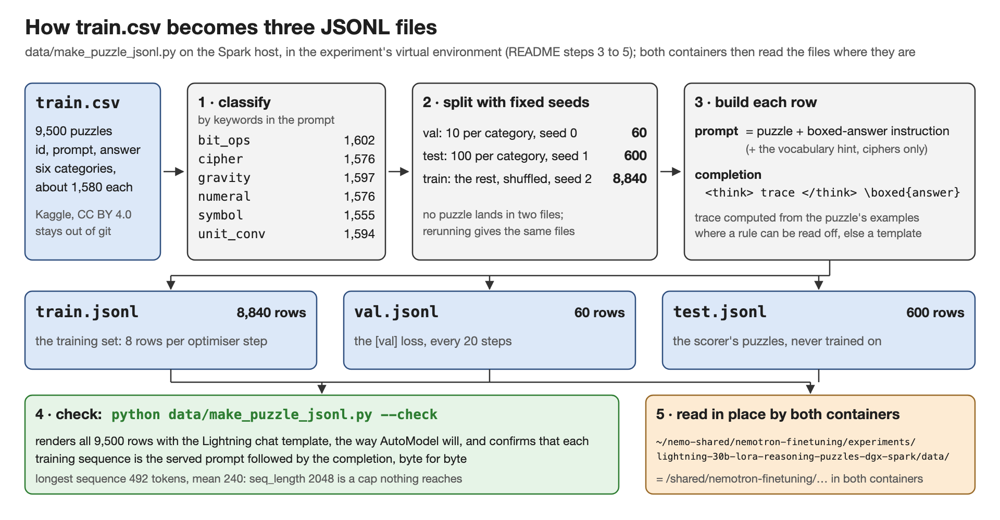
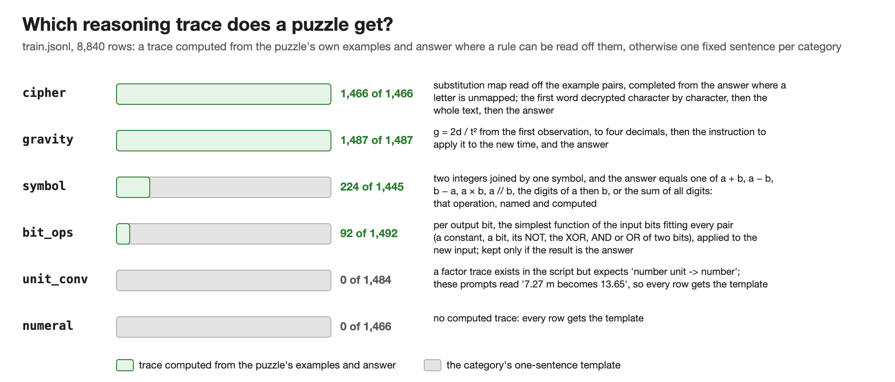
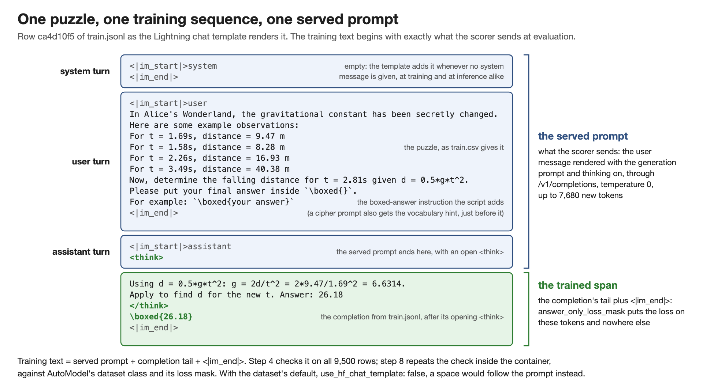

# Nemotron 3.5 Lightning 30B-A3B: LoRA on reasoning puzzles, one DGX Spark

*Part of [nemotron-finetuning](../../README.md).*

**LoRA-tune Nemotron 3.5 Lightning on the Kaggle reasoning puzzles on one DGX Spark with NVIDIA's single-GPU recipe, then score adapter against base on 600 held-out puzzles.** The Spark, containers and recipe are those of the [HellaSwag experiment](../lightning-30b-lora-hellaswag-dgx-spark/README.md), whose guide explains that shared setup and its failures; the steps below stand on their own.

> **Setup:** one DGX Spark (GB10, 128 GB) · `nvcr.io/nvidia/nemo-automodel:26.08` to train, `vllm/vllm-openai:v0.27.1` to serve · `nvidia/NVIDIA-Nemotron-3.5-Lightning-30B-A3B-BF16` · NVIDIA's single-GPU LoRA recipe, dataset swapped · a Python 3 venv on the Spark host for the data steps, no GPU.

## Contents

All steps run on the Spark, in order.

**Before the walkthrough:** [Data](#data) · [How a row is trained](#how-a-row-is-trained)

| Step | Task | Run from | Time |
|---|---|---|---|
| 1 | [Check the Spark and clone this repository](#step-1-check-the-spark-and-clone-this-repository) | Spark host | A few minutes |
| 2 | [Create the virtual environment](#step-2-create-the-virtual-environment) | Spark host | 2 minutes |
| 3 | [Get the competition data](#step-3-get-the-competition-data) | Spark host, in the venv | A few minutes |
| 4 | [Build the JSONL files](#step-4-build-the-jsonl-files) | Spark host, in the venv | Seconds |
| 5 | [Check the training text against the inference prefix](#step-5-check-the-training-text-against-the-inference-prefix) | Spark host, in the venv | Under a minute, plus the tokenizer download once |
| 6 | [Start the AutoModel container](#step-6-start-the-automodel-container) | Spark host, then `lightning-lora` | Minutes if the image and model are already on the Spark; otherwise the image pull and the 60 GB download |
| 7 | [Put the puzzle data into the recipe](#step-7-put-the-puzzle-data-into-the-recipe) | `lightning-lora` | 15 minutes |
| 8 | [Decode check and 20-step smoke run](#step-8-decode-check-and-20-step-smoke-run) | `lightning-lora` | About 30 minutes (estimate) |
| 9 | [Train 200 steps with validation](#step-9-train-200-steps-with-validation) | `lightning-lora` | 45 to 90 minutes (estimate) |
| 10 | [Free the GPU and serve base and adapter](#step-10-free-the-gpu-and-serve-base-and-adapter) | Second Spark terminal, then `vllm-lightning` | About 10 minutes |
| 11 | [Time the scorer on 12 puzzles](#step-11-time-the-scorer-on-12-puzzles) | Spark host, executing inside `lightning-lora` | Minutes |
| 12 | [Run the full 600-puzzle comparison](#step-12-run-the-full-600-puzzle-comparison) | Spark host, executing inside `lightning-lora` | 2 to 5 hours (estimate) |
| 13 | [Inspect the generations and write up](#step-13-inspect-the-generations-and-write-up) | Spark host | 3 to 4 hours |

**After the walkthrough:** [Results](#results) · [If it fails](if-it-fails.md) · [Files](#files-in-this-experiment) · [Licences](#third-party-material-and-licences) · [References](#references)

## Data

`train.csv` from the [NVIDIA Nemotron Reasoning Challenge](https://www.kaggle.com/competitions/nvidia-nemotron-model-reasoning-challenge): 9,500 rule-induction puzzles in six balanced categories, with the columns `id`, `prompt` and `answer`. One script makes three files:



*Classify, split with fixed seeds, build a prompt and completion per row, write three files, check them against the chat template; the containers read them in place.*

The figure also gives the split sizes and sequence lengths. Step 9 runs 200 steps of 8 rows, so training touches 1,600 of the 8,840 rows and no puzzle is seen twice.

Each line of `train.jsonl` is one training example with four fields. `id` and `category` identify the puzzle. `prompt` is the user message: the puzzle exactly as `train.csv` gives it, followed by the instruction to put the final answer inside `\boxed{}`; a cipher prompt also carries, as a hint, the 77-word vocabulary that every cipher plaintext is drawn from. `completion` is the assistant message the adapter learns to produce: a short reasoning trace between `<think>` and `</think>`, then the boxed answer. One example, with three observation lines cut:

```json
{"id": "ca4d10f5", "category": "gravity",
 "prompt": "In Alice's Wonderland, the gravitational constant has been secretly changed. Here are some example observations:\nFor t = 1.69s, distance = 9.47 m\n...\nNow, determine the falling distance for t = 2.81s given d = 0.5*g*t^2.\nPlease put your final answer inside `\\boxed{}`. For example: `\\boxed{your answer}`",
 "completion": "<think>\nUsing d = 0.5*g*t^2: g = 2d/t^2 = 2*9.47/1.69^2 = 6.6314. Apply to find d for the new t. Answer: 26.18\n</think>\n\\boxed{26.18}"}
```

The script writes the trace, not a model: where it can parse the puzzle's examples it writes the real derivation (the cipher map, `g`, the symbol's operation, a function per output bit) and ends with the known answer; every other row gets its category's one generic sentence, such as unit conversion's "I need to find the conversion factor from the given examples…":



*The share of each category with a computed trace, and the rule. The traces teach format and length more than a method.*

## How a row is trained

AutoModel turns each `prompt` and `completion` pair into one token sequence with the Lightning chat template (`use_hf_chat_template: true`). That template is the `chat_template.jinja` in the model's Hugging Face repository. It belongs to NVIDIA's Nemotron 3 template family and follows the ChatML convention: `<|im_start|>role … <|im_end|>` turns, an empty system turn when none is given, and a `<think>` opened by the generation prompt when thinking is on. The tokenizer, AutoModel and vLLM load that one file; nothing here defines it.

The sequence has two parts. The first is the served prompt: the system turn, the user turn with the puzzle, and the start of the assistant turn, `<|im_start|>assistant` and an open `<think>`. The scorer sends exactly this text at evaluation, so training starts from what the model will see in use. The second part is the completion: the rest of the trace, `</think>`, the boxed answer and the closing `<|im_end|>`.

The loss is where learning happens. At every position the model guesses the next token, and the training loss, a cross-entropy, measures how wrong that guess was. With `answer_only_loss_mask: true`, only the completion's tokens are scored. The prompt's tokens are read as context but never scored, so the adapter learns to continue a puzzle with a trace and a boxed answer, not to reproduce the puzzle. Training lowers this loss.



*The Data section's example, rendered. Blue: the served prompt, sent unchanged by the scorer; the model reads it but is never scored on it. Green: the completion; the model is scored only on predicting these tokens, so they are the only ones it learns from.*

Step 5 checks that all 9,500 rows render this way; step 8 repeats the check inside the container.

## Prepare the data (Spark host, venv)

Everything lives in one folder of this repository's git clone:

```text
~/nemo-shared/                      on the host; both containers mount it as /shared
└── nemotron-finetuning/            this repository, git-cloned in step 1
    └── experiments/lightning-30b-lora-reasoning-puzzles-dgx-spark/   E in the container commands
        ├── .venv/                  step 2: the host's Python environment               ignored by git
        ├── data/                   steps 3 to 5 add train.csv and three JSONL files    ignored; the script and README are tracked
        ├── configs/puzzles_lora.yaml   step 7: the recipe as run                       commit it after the run (step 13)
        ├── checkpoints/            steps 8 and 9: the adapters                         ignored
        └── logs/                   steps 8 to 12: training and scorer output           ignored
```

`E` is a shell variable: each container command block starts by setting it to this path, since every `docker exec … bash` is a fresh shell. Nothing is copied between host and containers; one folder is `~/nemo-shared/…` on the host and `/shared/…` inside them.

### Step 1: Check the Spark and clone this repository

**Run on the Spark host**, outside any container. If the clone already exists: `git -C ~/nemo-shared/nemotron-finetuning pull` instead. If Git is missing: `sudo apt-get install -y git`.

```bash
nvidia-smi -L && free -g && df -h ~            # GB10; about 120 GB in total; about 200 GB free
mkdir -p ~/nemo-shared
git clone https://github.com/priyanlc/nemotron-finetuning ~/nemo-shared/nemotron-finetuning
```

### Step 2: Create the virtual environment

**Run on the Spark host.** This uses the Spark's own Python 3 (3.12 on DGX OS 7; 3.10 or newer works) and needs no GPU and no PyTorch.

```bash
cd ~/nemo-shared/nemotron-finetuning/experiments/lightning-30b-lora-reasoning-puzzles-dgx-spark
python3 --version
python3 -m venv .venv                          # if this fails: sudo apt-get install -y python3-venv
source .venv/bin/activate
pip install -r requirements.txt
python -c "import polars, transformers, jinja2; print(polars.__version__, transformers.__version__, jinja2.__version__)"
```

Expected: `2.0.0 5.20.1 3.1.6` after a PyTorch-not-found warning (harmless: only the tokenizer is used); every pin has Linux aarch64 wheels. Steps 3 to 5 run with this venv active, in this folder.

### Step 3: Get the competition data

**Run on the Spark host, in the venv.** The Kaggle CLI downloads `train.csv` into `data/` for an account that has accepted the competition's rules on its [data page](https://www.kaggle.com/competitions/nvidia-nemotron-model-reasoning-challenge/data). The Spark has no browser, so the CLI prints a login link to open on any other device; or save an API token from your Kaggle settings as `~/.kaggle/kaggle.json`.

```bash
kaggle auth login --no-launch-browser
kaggle competitions download -c nvidia-nemotron-model-reasoning-challenge -p data
python -m zipfile -e data/nvidia-nemotron-model-reasoning-challenge.zip data
sha256sum data/train.csv                       # compare with data/README.md
```

### Step 4: Build the JSONL files

**Run on the Spark host, in the venv:**

```bash
python data/make_puzzle_jsonl.py
```

Expected output, in a few seconds:

```text
train.jsonl: 8840 rows {'bit_ops': 1492, 'cipher': 1466, 'gravity': 1487, 'numeral': 1466, 'symbol': 1445, 'unit_conv': 1484}
val.jsonl: 60 rows {'bit_ops': 10, 'cipher': 10, 'gravity': 10, 'numeral': 10, 'symbol': 10, 'unit_conv': 10}
test.jsonl: 600 rows {'bit_ops': 100, 'cipher': 100, 'gravity': 100, 'numeral': 100, 'symbol': 100, 'unit_conv': 100}
cipher vocabulary hint: 77 words
```

### Step 5: Check the training text against the inference prefix

**Run on the Spark host, in the venv.** The check needs the Lightning tokenizer: accept the model's terms on Hugging Face and log in once; the download is a few MB into `~/.cache/huggingface`.

```bash
hf auth login                              # once; token from huggingface.co/settings/tokens
python data/make_puzzle_jsonl.py --check
```

If the containers' cache already holds the model, skip the login and read it in place: `HF_HOME=~/nemo-shared/.cache/huggingface HF_HUB_OFFLINE=1 python data/make_puzzle_jsonl.py --check` (the cache belongs to root, but reading it is fine).

`--check` rebuilds the files, renders every row as AutoModel will (three turns through the chat template) and as the scorer will (user turn plus generation prompt), and requires the first to equal the second plus the completion and `<|im_end|>`. Expected, after the four lines of step 4 print again, in about ten seconds:

```text
train.jsonl: 8840 rows render as prefix + completion; prompt tokens max 392, mean 184; completion tokens max 191, mean 56; total max 492, mean 240; rows over 2048: 0
val.jsonl: 60 rows render as prefix + completion; prompt tokens max 353, mean 184; completion tokens max 108, mean 55; total max 461, mean 239; rows over 2048: 0
test.jsonl: 600 rows render as prefix + completion; prompt tokens max 382, mean 185
check OK
```

A `FAILED:` line: stop; the training text differs from what the model is served. A `PermissionError` or a refused download: [if-it-fails.md](if-it-fails.md).

## Train: in the AutoModel container

### Step 6: Start the AutoModel container

**Run on the Spark host.** If the container already exists, `docker start -ai lightning-lora` reopens it (`Ctrl-p`, `Ctrl-q` detaches; `docker attach lightning-lora` returns): skip to the last block. Otherwise:

```bash
docker run -it \
  --name lightning-lora \
  --gpus all --network host \
  --shm-size=32g --ulimit memlock=-1 --ulimit stack=67108864 \
  -e HF_HOME=/shared/.cache/huggingface \
  -e OMP_NUM_THREADS=8 -e MKL_NUM_THREADS=8 \
  -e PYTORCH_CUDA_ALLOC_CONF=expandable_segments:True \
  -v ~/nemo-shared:/shared \
  nvcr.io/nvidia/nemo-automodel:26.08
```

Key options: `-v ~/nemo-shared:/shared` is the mount in the tree above and `HF_HOME` keeps the model cache inside it; `--shm-size=32g` gives data loading shared memory; `OMP_NUM_THREADS=8` sets the CPU threads used when loading experts.

**Inside `lightning-lora`**, download the model once (accept its OpenMDW-1.1 terms first; the container's cache is `/shared/.cache/huggingface`, so the host login from step 5 does not carry over):

```bash
hf auth login                 # token from huggingface.co/settings/tokens
hf download nvidia/NVIDIA-Nemotron-3.5-Lightning-30B-A3B-BF16
```

Then set `E` and check that the data is visible:

```bash
E=/shared/nemotron-finetuning/experiments/lightning-30b-lora-reasoning-puzzles-dgx-spark
mkdir -p $E/checkpoints $E/logs
ls $E/data                                     # README.md  make_puzzle_jsonl.py  test.jsonl  train.csv  train.jsonl  val.jsonl
```

### Step 7: Put the puzzle data into the recipe

**Run inside `lightning-lora`.** Copy NVIDIA's recipe, delete its `dataset:` block (NVIDIA's sample dataset) and append [`configs/custom-dataset-block.yaml`](configs/custom-dataset-block.yaml) (train and validation datasets on the JSONL files, plus the validation dataloader). Nothing else changes: LoRA rank 8, alpha 32, AdamW 1e-4 to 1e-5, batch 8 × 1.

```bash
cp $E/configs/nemotron_nano_v3_5_lightning_singlegpu_lora.yaml $E/configs/puzzles_lora.yaml
sed -i '/^dataset:$/,/^  split: train$/d' $E/configs/puzzles_lora.yaml
grep -c hellaswag $E/configs/puzzles_lora.yaml                                       # expect 0
cat $E/configs/custom-dataset-block.yaml >> $E/configs/puzzles_lora.yaml
grep -n '^[a-z_]*:' $E/configs/puzzles_lora.yaml      # dataset, validation_dataset, validation_dataloader once each
```

Keep that order: `sed` must run before `cat`, because the appended block also contains `split: train` and would be deleted; and append only once.

### Step 8: Decode check and 20-step smoke run

**Run inside `lightning-lora`.** The decode check loads only the tokenizer and the dataset class. Every `val.jsonl` row must decode to the template's native render, with the loss on the assistant turn only.

```bash
python3 - <<'EOF'
import json
from transformers import AutoTokenizer
from nemo_automodel.components.datasets.llm.column_mapped_text_instruction_dataset import ColumnMappedTextInstructionDataset
E = "/shared/nemotron-finetuning/experiments/lightning-30b-lora-reasoning-puzzles-dgx-spark"
tok = AutoTokenizer.from_pretrained("nvidia/NVIDIA-Nemotron-3.5-Lightning-30B-A3B-BF16")
ds = ColumnMappedTextInstructionDataset(
    path_or_dataset_id=f"{E}/data/val.jsonl", column_mapping={"question": "prompt", "answer": "completion"},
    tokenizer=tok, use_hf_chat_template=True, answer_only_loss_mask=True,
    seq_length=2048, padding="do_not_pad", truncation="longest_first")
rows = [json.loads(l) for l in open(f"{E}/data/val.jsonl")]
for i, r in enumerate(rows):
    s = ds[i]
    text = tok.decode(s["input_ids"])
    expected = tok.apply_chat_template(
        [{"role": "user", "content": r["prompt"]}, {"role": "assistant", "content": r["completion"]}], tokenize=False)
    assert text.rstrip("\n") == expected.rstrip("\n"), (i, text[-200:])
    target = tok.decode([l for l in s["labels"] if l != -100])
    assert target.rstrip("\n").endswith("<|im_end|>"), (i, target[-80:])
    assert "<think>\n" in target and "\\boxed{" in target and "<think>\n " not in text, (i, target[:120])
    assert r["prompt"][:60] not in target, (i, "prompt tokens are in the loss")
s0 = ds[0]
print(len(rows), "rows OK; supervised tokens in row 0:", sum(l != -100 for l in s0["labels"]), "of", len(s0["input_ids"]))
print("loss span of row 0 starts:", repr(tok.decode([l for l in s0["labels"] if l != -100])[:70]))
EOF
```

Pass: `60 rows OK`, a supervised count well below the sequence length, a loss span from (or just after) `<|im_start|>assistant` to `<|im_end|>`. An assertion failure: do not train ([if-it-fails.md](if-it-fails.md) has the fallback).

Then run NVIDIA's unchanged 20-step schedule with validation at step 10, inside `tmux` so a dropped connection does not kill it (`Ctrl-b`, `d` detaches; `tmux attach -t train` returns):

```bash
apt-get update && apt-get install -y tmux && tmux new -s train     # or tmux attach -t train
E=/shared/nemotron-finetuning/experiments/lightning-30b-lora-reasoning-puzzles-dgx-spark
cd /opt/Automodel
RUN=puzzles-test
test -e $E/checkpoints/$RUN && echo "exists, pick another name" || \
CUDA_VISIBLE_DEVICES=0 automodel $E/configs/puzzles_lora.yaml \
  --nproc-per-node 1 \
  --step_scheduler.val_every_steps 10 \
  --checkpoint.checkpoint_dir $E/checkpoints/$RUN \
  2>&1 | tee $E/logs/$RUN.log
```

Loading takes minutes; then come 20 step records, two `[val]` lines, and the adapter at `$E/checkpoints/puzzles-test/epoch_0_step_19/model/`. Read the run folder:

```bash
python3 -c "
import json
rows = [json.loads(l) for l in open('$E/checkpoints/puzzles-test/training.jsonl')]
print(sorted(rows[0]))
for r in rows[::4] + rows[-1:]: print({k: r.get(k) for k in ('step', 'loss', 'grad_norm', 'lr', 'mem', 'tps')})"
grep '\[val\]' $E/logs/puzzles-test.log
ls $E/checkpoints/puzzles-test/epoch_0_step_19/model/
```

Pass before step 9: `mem` around 62 GiB (stop above 90); `loss` falling; `grad_norm` finite; two `[val]` lines; `adapter_model.safetensors` and `adapter_config.json` present; seconds per step noted from the log timestamps.

### Step 9: Train 200 steps with validation

**Run inside `lightning-lora`, in `tmux`.** The schedule is 200 steps of 8 rows with validation and a checkpoint every 20 steps, so AutoModel's `LOWEST_VAL` link, which names the checkpoint with the lowest validation loss, can pick any of ten. The run name is timestamped, and an existing folder is refused because AutoModel resumes any run whose folder exists:

```bash
E=/shared/nemotron-finetuning/experiments/lightning-30b-lora-reasoning-puzzles-dgx-spark
cd /opt/Automodel
RUN=puzzles-200-$(date +%m%d-%H%M)
test -e $E/checkpoints/$RUN && echo "exists, pick another name" || \
CUDA_VISIBLE_DEVICES=0 automodel $E/configs/puzzles_lora.yaml \
  --nproc-per-node 1 \
  --step_scheduler.max_steps 200 --step_scheduler.val_every_steps 20 --step_scheduler.ckpt_every_steps 20 \
  --checkpoint.checkpoint_dir $E/checkpoints/$RUN \
  2>&1 | tee $E/logs/$RUN.log
echo "run: $RUN"; grep '\[val\]' $E/logs/$RUN.log
```

Expect 10 to 20 s per step (a run on sequences a third as long took 7 s), 35 to 70 minutes after loading. Then name the run and pick the checkpoint:

```bash
ln -sfn $RUN $E/checkpoints/puzzles-200
ln -sf $RUN.log $E/logs/puzzles-200.log
readlink $E/checkpoints/puzzles-200/LOWEST_VAL        # the step with the lowest validation loss
python3 -c "
import json
for r in map(json.loads, open('$E/checkpoints/puzzles-200/validation.jsonl')): print({k: r.get(k) for k in ('step', 'val_loss', 'lr', 'mem')})"
ls $E/checkpoints/puzzles-200/LOWEST_VAL/model/
```

Serve `LOWEST_VAL` in step 10 and record its step; validation loss on 60 rows is noisy, so note in the write-up if it beats step 199 only by a hair. If the loss is still falling clearly at step 199, start a fresh 400-step run in a new folder; resuming would keep the old learning-rate schedule.

## Evaluate with vLLM

### Step 10: Free the GPU and serve base and adapter

**Run on the Spark host, in a second terminal**, once training is done and `free -g` shows the memory back:

```bash
docker run -it --rm --name vllm-lightning \
  --gpus all --ipc=host --network host \
  -v ~/nemo-shared:/shared \
  -e HF_HOME=/shared/.cache/huggingface \
  --entrypoint /bin/bash \
  vllm/vllm-openai:v0.27.1
```

**Inside `vllm-lightning`**, serve both under two names:

```bash
E=/shared/nemotron-finetuning/experiments/lightning-30b-lora-reasoning-puzzles-dgx-spark
vllm serve nvidia/NVIDIA-Nemotron-3.5-Lightning-30B-A3B-BF16 \
  --served-model-name lightning-base \
  --max-model-len 8192 \
  --gpu-memory-utilization 0.80 \
  --mamba-backend flashinfer \
  --enable-lora --max-lora-rank 8 \
  --lora-modules lightning-puzzles=$E/checkpoints/puzzles-200/LOWEST_VAL/model
```

`--max-model-len 8192` plus the 7,680-token budget mirrors the competition; `--max-lora-rank` must equal the adapter's rank. Wait for `Application startup complete`.

### Step 11: Time the scorer on 12 puzzles

[`tools/compare_puzzles.py`](../../tools/compare_puzzles.py) scores both served models on `test.jsonl` the way the competition does: greedy decoding, up to 7,680 new tokens, the last `\boxed{…}` taken as the answer, and no box or a truncated generation counted wrong. It reports per-category accuracy, answers fixed and broken, the gain with a paired 95% interval and an exact McNemar p-value. Method and options: [tools/README.md](../../tools/README.md#compare_puzzlespy).

**Run on the Spark host, in a terminal separate from the server.** The script runs inside `lightning-lora`, which has transformers, the cached tokenizer and the host network; its defaults are this experiment's `data/test.jsonl` and `logs/`. Self-test, then 12 puzzles, two per category:

```bash
E=/shared/nemotron-finetuning/experiments/lightning-30b-lora-reasoning-puzzles-dgx-spark
docker start lightning-lora
docker exec -it lightning-lora python3 /shared/nemotron-finetuning/tools/compare_puzzles.py --selftest
docker exec -it lightning-lora python3 /shared/nemotron-finetuning/tools/compare_puzzles.py --n 12 --out $E/logs/compare-12.csv
```

Read one generation per model first:

```bash
docker exec -it lightning-lora python3 -c "
import json
rows = [json.loads(l) for l in open('$E/logs/compare-12-generations.jsonl')]
for r in rows[:2]: print('==', r['model'], r['finish'], r['tokens'], 'tokens, pred', r['pred']); print(r['text'][:1200])"
```

Multiply the 12-puzzle time by 50; expect hours, since base traces run to thousands of tokens. If that does not fit your time, use `--n 300` (50 per category) and say so in the write-up.

### Step 12: Run the full 600-puzzle comparison

**Run on the Spark host, in the second terminal:**

```bash
docker exec -it lightning-lora bash -c "python3 /shared/nemotron-finetuning/tools/compare_puzzles.py --n 0 --concurrency 16 \
  --out $E/logs/compare-600.csv 2>&1 | tee $E/logs/compare-600.log"
```

It prints step 11's report plus the truncation counts; `logs/` gets the per-row CSV, a `.json` summary and `-generations.jsonl`. Both models get the same prompts, so this is adapter versus base under one procedure; a result near p = 0.05 deserves a second run, since vLLM's batching can flip a few greedy answers. When done, `Ctrl-C` in the vLLM terminal stops the server.

### Step 13: Inspect the generations and write up

**Run on the Spark host.** Profile the generations, then count fixed and broken per category:

```bash
E=/shared/nemotron-finetuning/experiments/lightning-30b-lora-reasoning-puzzles-dgx-spark
docker exec -it lightning-lora python3 -c "
import json, statistics as st
rows = [json.loads(l) for l in open('$E/logs/compare-600-generations.jsonl')]
for m in sorted({r['model'] for r in rows}):
    rs = [r for r in rows if r['model'] == m]; toks = sorted(r['tokens'] or 0 for r in rs)
    print(m, '| boxed answer', round(sum(r['pred'] is not None for r in rs) / len(rs), 3), '| hit the limit', sum(r['finish'] == 'length' for r in rs),
          '| tokens median', st.median(toks), 'p90', toks[int(0.9 * len(toks)) - 1])"
docker exec -it lightning-lora python3 -c "
import csv, collections
c = collections.Counter()
for r in csv.DictReader(open('$E/logs/compare-600.csv')): c[(r['category'], r['base_ok'], r['adapter_ok'])] += 1
for cat in sorted({k[0] for k in c}):
    print(f'{cat:10} fixed {c[(cat, \"0\", \"1\")]:3}  broke {c[(cat, \"1\", \"0\")]:3}  both right {c[(cat, \"1\", \"1\")]:3}  both wrong {c[(cat, \"0\", \"0\")]:3}')"
```

Read a few adapter generations per category beside the base's, asking three things: does the think block repeat the training template verbatim, is the box always present, and does the base run out of tokens? Then update this folder as the [template](../_template/README.md) asks: README status and results, `configs/puzzles_lora.yaml` as run, `results/validation-loss.csv` from `checkpoints/puzzles-200/validation.jsonl`, `results/puzzles-600.csv` from the per-row CSV, and `results/README.md`.

## Results

The run's files go under `results/`.

## Files in this experiment

| Path | What it is |
|---|---|
| `README.md` | This guide. |
| `if-it-fails.md` | Failures specific to this experiment, and what to do. |
| `requirements.txt` | Pinned packages for the venv of steps 2 to 5. |
| `data/make_puzzle_jsonl.py` | Builds and checks the JSONL files (steps 4 and 5). |
| `data/README.md` | The data files, licence and checksum. |
| `configs/custom-dataset-block.yaml` | Dataset blocks appended in step 7. |
| `configs/puzzles_lora.yaml` | Step 7's recipe with the puzzle dataset. |
| `configs/nemotron_nano_v3_5_lightning_singlegpu_lora.yaml` | NVIDIA's recipe, verbatim; step 7 copies it. |
| `../../tools/compare_puzzles.py` | The scorer (steps 11 and 12). |
| `assets/` | The diagrams and `diagrams.py`, which draws them. |

## Third-party material and licences

- Model `nvidia/NVIDIA-Nemotron-3.5-Lightning-30B-A3B-BF16` (OpenMDW-1.1); containers `nvcr.io/nvidia/nemo-automodel:26.08` (NVIDIA Software License Agreement) and `vllm/vllm-openai:v0.27.1` (Apache-2.0); none redistributed.
- NVIDIA's recipe, `configs/nemotron_nano_v3_5_lightning_singlegpu_lora.yaml` (Apache-2.0, licence header kept).
- The puzzle data: NVIDIA via Kaggle, [CC BY 4.0](https://creativecommons.org/licenses/by/4.0/); not committed; derived files in [`data/README.md`](data/README.md).

## References

- AutoModel's `ColumnMappedTextInstructionDataset`: https://github.com/NVIDIA-NeMo/Automodel/blob/main/nemo_automodel/components/datasets/llm/column_mapped_text_instruction_dataset.py
- NVIDIA's DGX Station Lightning LoRA recipe (the `make_agent_chat_dataset` fallback): https://github.com/NVIDIA-NeMo/Nemotron/blob/main/usage-cookbook/Nemotron-3.5-Lightning/dgx-station-recipes/lora.md
- Nemotron 3.5 Lightning model card: https://huggingface.co/nvidia/NVIDIA-Nemotron-3.5-Lightning-30B-A3B-BF16

*Licences: [LICENSES.md](../../LICENSES.md).*
